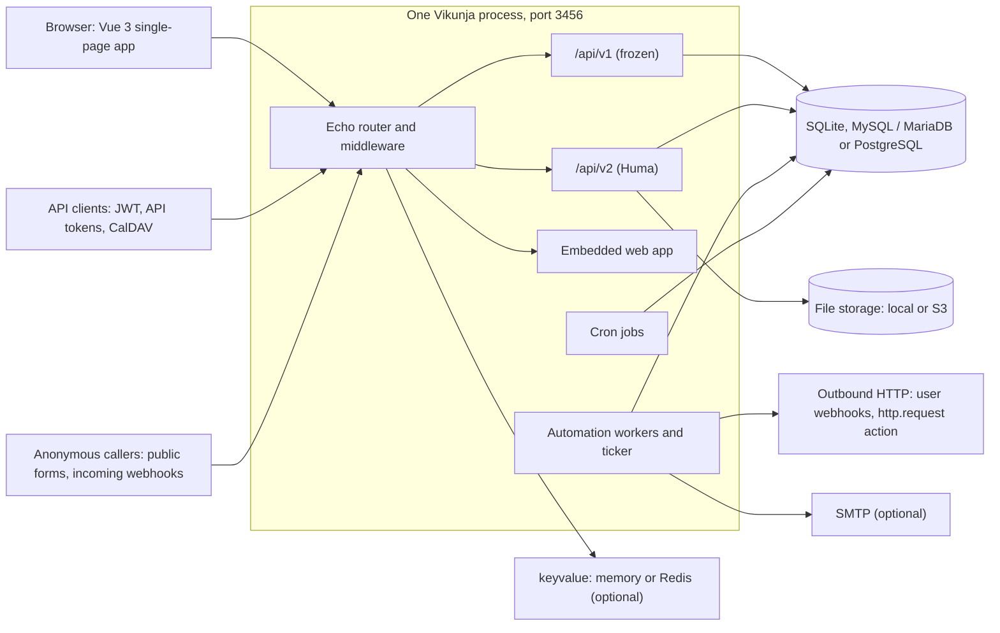
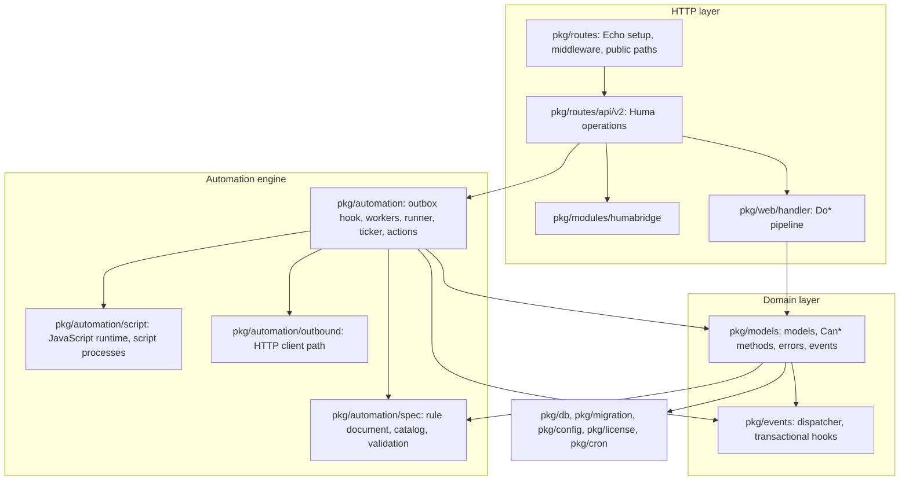
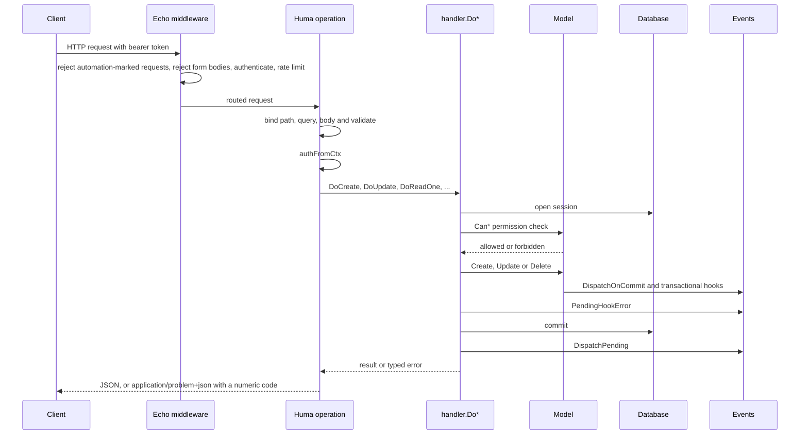
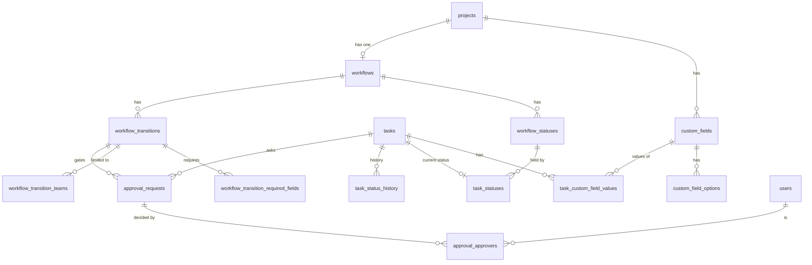
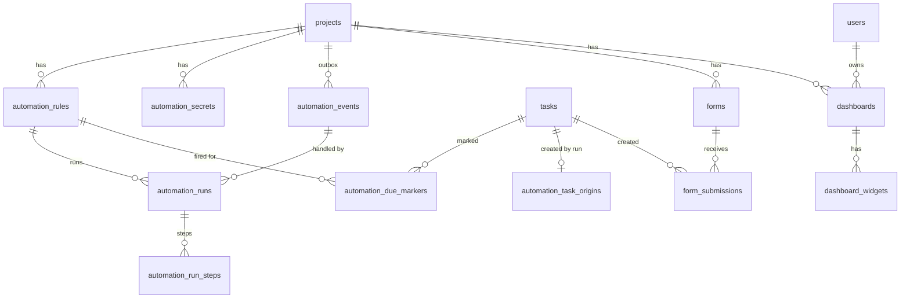
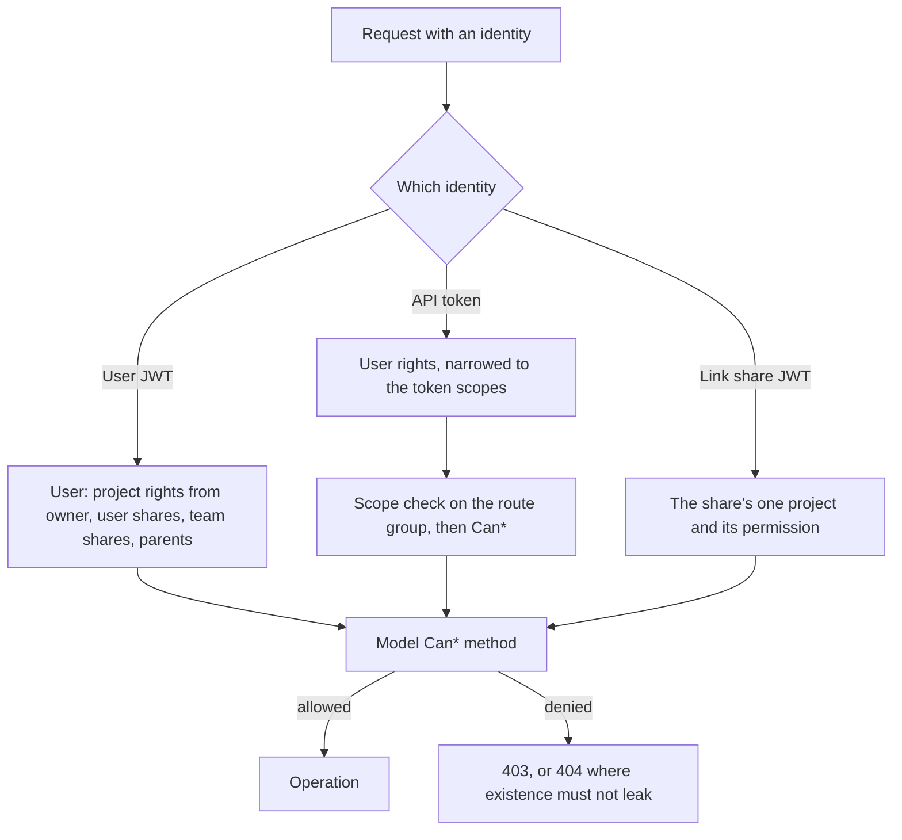
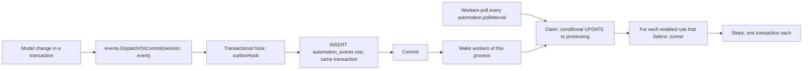
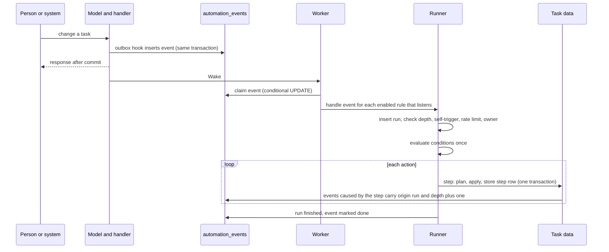
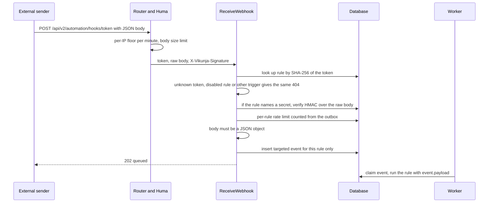

# Architecture

This document describes how vikunja-enterprise is built and why. It covers the whole system, but the focus is on what the fork adds to upstream Vikunja: custom fields, workflows, approvals, automation, dashboards and reports, and forms.

Where a diagram appears, the text next to it carries the same information. Where this document and the code disagree, the code is right; please report the difference.

Related documents: [README.md](README.md) (overview), [API.md](API.md) (HTTP surface), [DESIGN.md](DESIGN.md) (screens), [docs/modules/](docs/modules/README.md) (one reference page per module) and [docs/enterprise/](docs/enterprise/ROADMAP.md) (design history and status).

## Contents

- [System context and deployment](#system-context-and-deployment)
- [Repository and package map](#repository-and-package-map)
- [Request lifecycle on /api/v2](#request-lifecycle-on-apiv2)
- [Data model](#data-model)
- [Permission model](#permission-model)
- [Events and the automation engine](#events-and-the-automation-engine)
- [Workflow and status model](#workflow-and-status-model)
- [Reports](#reports)
- [Public surface](#public-surface)
- [Database portability and migrations](#database-portability-and-migrations)
- [Frontend architecture](#frontend-architecture)
- [Architecture decisions](#architecture-decisions)

## System context and deployment

Vikunja is one Go binary. The same process serves the JSON API, the single-page web app (embedded into the binary from `frontend/dist`), WebSocket notifications, the optional MCP endpoint, and the automation workers. The image built by this repository's `Dockerfile` contains that one binary on a `scratch` base and listens on port `3456`.

What the picture says:

- **One process.** There is no separate worker container and no queue server. Durable background work is a table in the main database (the automation outbox), and the workers are goroutines in the same process.
- **Database.** SQLite (the image default, a file under `/db`), or PostgreSQL, chosen with `database.type`. These two are tested and supported. MySQL and MariaDB are compatible by design: every query and migration of the fork is written to run on them, but the fork does not test them. See [Database portability and migrations](#database-portability-and-migrations).
- **Files.** Attachments, avatars and form logos go to the configured file backend (`files.type`: `local` or `s3`). A form logo is stored as a normal file and referenced by `forms.brand_logo_file_id`.
- **Optional pieces.** SMTP (`mailer.*`) for e-mail notifications, Redis (`keyvalue.type`, `redis.*`) for the key-value store and rate-limit counters, Prometheus metrics (`metrics.*`), and Sentry. None is required. The automation metrics `vikunja_automation_runs_total` and `vikunja_automation_events` exist only with `metrics.enabled`.
- **Outbound traffic** from automation (`http.request`, `http.fetch`) and from upstream's user webhooks goes through the same SSRF-protected HTTP client (`outgoingrequests.*`).
- **TLS** is not terminated by the image. Put a reverse proxy in front and set `service.ipextractionmethod` and `service.trustedproxies`, because the per-IP limits of public forms and webhooks use the address the router determines.

### Several instances

Running several replicas against one database is possible, and the fork's engine is written for it:

- Events are claimed by a conditional `UPDATE`, so a row is processed by exactly one worker, in this process or another.
- The ticker (schedules, overdue, due soon) claims each firing in the database, so replicas never fire twice.
- Workers of a replica find events written by other replicas by polling (`automation.pollinterval`).

What is per process and therefore only eventually consistent: the cache of which events a project's rules listen to (`automation.cachettl`, 30 s: a rule enabled on replica A can miss events written by replica B for up to that long), and the in-memory report cache (`reports.cachettl`, 30 s). Rate-limit counters follow `ratelimit.store` and `keyvalue.type`. Which replica count has actually been tested is recorded in the [roadmap](docs/enterprise/ROADMAP.md), not here.

## Repository and package map

The rule for the fork is: **new features live in their own packages, files and tables, and upstream files are touched as little as possible**, so that upstream can be merged. Measured with `git diff --name-status` against the commit the fork was created from, the changes in `pkg/` and `frontend/src/` are mostly added files; about 40 upstream Go files and about 40 upstream frontend files are modified, and most of those modifications are small hooks (an extra expand, a filter field, a cleanup call, a route).

| Area | Upstream | Added by the fork |
|---|---|---|
| Models and permissions | `pkg/models` (tasks, projects, kanban, labels, ...) | `custom_field*.go`, `workflow*.go`, `approvals*.go`, `automation_*.go`, `dashboards*.go`, `reports*.go`, `forms*.go`, `csv_export.go`, and the matching `error_*.go` files |
| Engine | - | `pkg/automation/**` (outbox hook, workers, runner, ticker, actions, dry run, secrets, script host, `spec`, `script`, `outbound`) |
| API v2 | `pkg/routes/api/v2` (tasks, projects, auth, ...) | `custom_fields.go`, `workflow.go`, `approvals.go`, `automation.go`, `automation_hooks.go`, `automation_secrets.go`, `dashboards.go`, `reports.go`, `forms.go`, `forms_public.go` |
| Router | `pkg/routes/routes.go` | `pkg/routes/automation_guard.go`, public path lists in `routes.go`, API token scope entries in `pkg/models/api_routes.go` |
| Events | `pkg/events` | `RegisterTransactionalHook`, `PendingHookError` (small additions to `events.go`; `handler/core.go` checks the hook error before committing) |
| Migrations | `pkg/migration` | ten files dated `20261122120000` to `20261128100000` |
| Config | `pkg/config`, `config-raw.json` | the `automation.*`, `reports.*` and `forms.*` keys |
| License | `pkg/license` | `Init` no longer reads a key; every feature is enabled |
| Frontend | `frontend/src/**` | `components/{custom-fields,workflow,approvals,automation,dashboards,charts,forms}`, `views/{approvals,dashboards,forms}`, project settings pages, `client/queries/*` for each module, `helpers/*` for each module |
| Tests | `pkg/**/*_test.go`, `pkg/webtests` | tests next to every added file, fixtures in `pkg/db/fixtures` |

`veans/` is a separate Go module and `desktop/` is GPL-licensed; neither is touched by the fork.

## Request lifecycle on /api/v2

`/api/v2` is built with [Huma](https://huma.rocks) on top of Echo. Every operation is registered with `huma.Operation` in `pkg/routes/api/v2/`, and the OpenAPI document is generated from the Go types.

Step by step:

1. **Middleware** (`registerAPIRoutesV2` in `pkg/routes/routes.go`): `rejectAutomationRequests` answers `508` to any request carrying the automation marker header, `rejectFormBodies` refuses `application/x-www-form-urlencoded` bodies (except the OAuth token endpoint), `Cache-Control: no-store` is set, `SetupTokenMiddleware` authenticates the request (a user JWT, an API token with the `tk_` prefix, or a link-share JWT), rate limits are applied to credential, refresh, public form and hook paths and, when `ratelimit.enabled` is on, to the rest, and `/api/v2/admin/*` is gated to instance admins.
2. **Binding and validation.** `Register` wraps `huma.Register`: after Huma has bound and schema-validated the input, `govalidator` tags on the model are checked (`validateInputBody`) before the handler runs, so v2 validates first and authorizes second, like v1. A validation failure is `422`.
3. **Authentication in the handler.** `authFromCtx` returns the `web.Auth` (a user or a link share) or a generic `401`.
4. **The `handler.Do*` pipeline** (`pkg/web/handler/core.go`) opens a database session, calls the model's `Can*` method, performs the operation, checks `events.PendingHookError`, commits, and only then dispatches the collected events. A rollback discards them (`events.CleanupPending`). The fork models most actions as small structs whose `CanCreate` carries the check (`ApprovalDecision`, `ApprovalCancel`, `TaskStatusChange`, `AutomationRunRetry`), so they still run through `DoCreate`. Handlers that have no `Do*` equivalent, such as the automation dry run, load the entity and call `Can*` themselves.
5. **Permissions live in the model**, never in the handler: `CanRead`, `CanCreate`, `CanUpdate`, `CanDelete`. See [Permission model](#permission-model).
6. **Errors.** Domain errors implement `HTTPError()` and are translated by `translateDomainError` into an RFC 9457 `application/problem+json` body with Vikunja's numeric `code`, optional `i18n_params` and optional `details`. See [API.md](API.md#errors).
7. **Reads** send an `ETag` and honour `If-None-Match` where the operation says so; PATCH operations are synthesised by Huma's AutoPatch from a GET and a PUT on the same path.

Routes are registered by `init()` functions through `AddRouteRegistrar`, so a new resource file is picked up without editing a central list.

## Data model

The fork adds 24 tables and changes no upstream table: where it needs per-task data it uses a table keyed by `task_id` instead of a new column on `tasks` (see decision 12). Five of the fork's own tables (`workflow_transitions`, `task_status_history`, `forms`, `automation_events`, `automation_rules`) were extended by later fork migrations with `partialSync`.

First diagram: custom fields, workflows and approvals.

Second diagram: automation, forms and dashboards.

Notes on the tables (columns are in the [module pages](docs/modules/README.md)):

- Ids are `bigint` primary keys; relations are plain id columns with indexes, not foreign-key constraints, like upstream.
- **JSON columns** keep documents that are only read and written as a whole and never filtered in SQL: `automation_rules.trigger`, `conditions` and `actions`, `forms.fields` and `settings`, `dashboard_widgets.config`, `custom_fields.config`, `workflow_transitions.approval`. Everything that is filtered or sorted by SQL is a typed column: custom field values live in `value_text`, `value_number`, `value_date`, `value_bool`, `option_id` and `user_id`, so `cf_<id>` filters and sorts run in SQL.
- **Unique constraints carry the invariants**: one workflow per project (`workflows.project_id`), one status per task (`task_statuses.task_id`), one run per (event, rule) (`automation_runs`), one step per (run, position), one marker per (rule, task) (`automation_due_markers`), one origin per task, one secret name per project, one form token (`forms.token`), one decision slot per (request, user) (`approval_approvers`).
- `dashboards.project_id` is `0` for a personal dashboard (the column is `not null default 0`), so the project relation in the diagram applies to project dashboards only.
- `automation_events.task_id`, `rule_id`, `origin_run_id`, and `approval_requests.transition_id`, `from_status_id`, `to_status_id` are nullable or zero where the concept does not apply (an event without a task, an ad-hoc approval).
- Status history keeps the status titles (`from_title`, `to_title`) so it stays readable after a status or a whole workflow is deleted.

## Permission model

Nothing the fork adds has its own permission logic. Everything goes through the model's `Can*` methods, which are built on the project rights upstream already has: **read**, **write** and **admin** on a project, derived from direct shares, team shares, parent projects, ownership and link shares.

| What | Needed |
|---|---|
| Custom field definitions: read; create, update, delete | read on the project; admin on the project |
| Custom field values: read; set, clear | read on the task; write on the task |
| Workflow: read; replace, delete | read on the project; admin |
| Change a task's status | write on the task, plus the transition's own minimum permission (`write` or `admin`) and optional allowed teams |
| Automation rules, runs, secrets, webhook address | admin on the project (reading too, because conditions and errors can reveal other users' data) |
| Run a manual rule on a task | write on the task |
| Dashboards | personal: its owner only; project: read for everyone who can read the project, change for project admins |
| Reports | whatever the viewer can read (below) |
| Forms: builder, submissions | admin on the project, never for link shares |
| Approvals | read on the task to see a request; an approver decides; the requester or a project admin cancels; link shares have nothing |

Principles that cut across modules:

- **A dashboard never shows more than its viewer may read.** Every report is computed over the tasks returned by the same query the task list uses (`TaskCollection.readableTasksQuery`: project access, shares, teams, favorites, link shares pinned to their project). There is no second permission implementation to drift. A test matrix asserts that report totals equal task list totals across viewers, filters and scopes. Group labels (users, labels, statuses) are looked up only for keys that occur on those tasks.
- **A rule runs as its owner.** The user who saves a rule becomes its owner, so nobody can borrow another admin's rights by editing their rule. Every action and every `vikunja.*` call of a script goes through the same model functions and permission checks as a hand-made change, as the owner, in the transaction of the step. The owner is checked again when a run starts and when the ticker is about to fire: an owner who is gone, or who no longer administers the project, disables the rule instead (`owner_unavailable`, `owner_not_admin`). A task the owner can no longer read is treated as gone. A rule therefore can never do more than its owner could do by hand.
- **A form creates tasks as its owner**, through the normal task create path, so workflows, custom field validation and automation apply. If the owner loses write access the form disables itself.
- **API token scopes.** Token permissions are groups of routes derived from the route paths (`projects_custom_fields`, `tasks_custom_field_values`, `projects_automations`, `projects_automations_runs`, `dashboards`, `approvals`, `projects_forms`, `projects_forms_submissions`, `tasks_approvals` are registered as standard CRUD groups in `pkg/models/api_routes.go`; other routes fall into groups derived from their path). Reading expanded data needs the scope of what is embedded: `expand=custom_fields` needs `tasks_custom_field_values` `read_all`, `expand=status` needs `tasks` `status`, `expand=approvals` needs `tasks_approvals` `read_all`. `GET /api/v2/routes` lists the available groups. Public paths need no scope.
- **Link shares** are not users. They can read what the share allows, never see approvals, never change dashboards, never administer forms, and cannot use the time tracking report.
- **Existence does not leak.** Unknown form tokens, webhook tokens that are disabled or have another trigger, and a custom field id of an unreadable project all answer the same error as an unknown id.

## Events and the automation engine

Upstream already dispatches domain events (`TaskCreatedEvent`, `TaskUpdatedEvent`, ...) in process after a transaction commits, through `events.DispatchOnCommit` and `DispatchPending`. The fork adds new events (`task.status.changed`, `task.custom-field-value.updated`, `custom-field.created|updated|deleted`, `approval.requested|decided|resolved`, `form.submitted`) and one new mechanism, the **transactional hook**.

**Transactional outbox.** `events.RegisterTransactionalHook` registers a function that `DispatchOnCommit` calls synchronously with the session of the surrounding transaction, before it commits. The automation hook inserts an `automation_events` row there, so the event commits or rolls back together with the change that caused it: it is never lost and never exists for a rolled back change. The `handler.Do*` functions check `events.PendingHookError` before committing, so a hook that could not write fails the request instead of silently losing the event. The one known gap: code that commits sessions itself (cron jobs, CalDAV, importers) does not run that check, so there a failed outbox insert is only logged. The hook writes a row only when `automation.enabled` is true and at least one enabled rule of the project listens to the event; that set is cached per project for `automation.cachettl`.

**Workers.** `automation.Init` (called from `initialize.FullInit`) starts `automation.workers` goroutines and one ticker goroutine in the same process, and registers a daily cleanup cron. A worker loop calls `ProcessPending` when woken (an event written by this process calls `Wake`) or when `automation.pollinterval` elapses.

**Claiming and locking.** A row is claimed with `UPDATE ... SET status = 'processing', locked_until = ?, attempts = attempts + 1 WHERE id = ? AND status = 'pending'` and used only when exactly one row changed. There is no `SKIP LOCKED`, so the same SQL runs on SQLite, MySQL and PostgreSQL, and two workers (in this process or another replica) never get the same row. Rows left in `processing` past `locked_until` go back to `pending`, or become `dead` when their attempts are used up; the lock is renewed before every rule of the event because each run has its own timeout. A worker that has nothing to recover does not write at all, because an idle write would take SQLite's write lock on every poll.

**At least once, idempotent.** Delivery is at least once. A run row is inserted first under a unique index on (event, rule), which makes a redelivery find the existing run. The row of a successful step is written in the same transaction as the step's work, so a step recorded as successful was applied exactly once, and a resumed run starts at the first step not recorded as successful. A failure that will repeat (a permission or workflow rejection, an invalid value, a vanished task) fails the run at once; anything else (a database error, a timeout) leaves the run `running` and puts the event back with exponential backoff (10 s, 20 s, 40 s, ...) until `automation.maxattempts`, after which the event is `dead` and the run `failed`. A run that is resumed checks that the steps it recorded still are the actions at their positions; if the rule was edited so that they are not, the run is aborted with `rule_changed`.

**The runner.** For one event and one rule the runner: matches the trigger; creates the run; checks the depth, the self-trigger guard, the per-rule rate limit and the owner; evaluates the conditions once, before the first action (a resumed run does not evaluate them again); then executes the actions as steps. Each step runs in its own session with its own timeout (`automation.steptimeout`), under the run timeout (`automation.runtimeout`). Every action exists as a *plan* (reads, checks, resolves templates; used by the dry run) and an *apply* (writes); a real step is plan followed by apply in one transaction. On SQLite a step begins with a no-op write to its run row, so concurrent steps wait for each other instead of failing on the first write after a read.

**Wait and resume.** The `wait` action does not sleep. It records the step and writes a `rule.resume` event due after the delay; the run stays `running`. When the event is due the runner continues with the actions after the wait, without evaluating the conditions again. A rule that was disabled or deleted meanwhile aborts the run. A project can have at most `automation.maxpendingwaits` runs waiting, `automation.waitmax` caps one wait, and a daily job fails runs that have been running longer than their waits plus a day (the resume event was lost).

**The ticker.** Time-based triggers do not come from model events. Every process runs `Tick` every `automation.ticker.interval`:

- A **schedule** rule stores `last_fired_at`; the ticker claims an occurrence with a conditional `UPDATE` of that column in the same transaction that writes the events, so only one replica fires it. Cron expressions are evaluated in the server's time zone (`service.timezone`); nothing fires for the time before the rule was last saved; a server that was down fires once for all missed occurrences.
- **Overdue** and **due soon** rules use *markers*: one row per (rule, task) in `automation_due_markers`, holding the due date it fired for. The unique index is the claim. A task fires once per due date, and a changed due date arms it again.
- **Arming.** When a rule is created, enabled again, or gets another trigger, it is *armed*: a marker is written for every task that already is overdue (or inside the due-soon window), at most 20000 in the transaction of the save, so tasks that were already late do not all fire at once. Editing the title, conditions or actions does not re-arm.
- The per-minute run limit does not apply to time-based triggers; the cap per tick (`automation.ticker.maxtasks`) and the scan cap (`automation.ticker.maxscan`) do.

**Loop guards.** Three independent layers keep a rule from feeding itself:

1. *Origin and depth.* Events written by an action of a run carry `origin_run_id` and `depth + 1` (the step's session is registered under the run, and the hook looks it up). An event deeper than `automation.maxdepth` is recorded as a skipped run (`max_depth`), and a rule never reacts to an event whose chain of origin runs contains a run of the same rule (`self_trigger`).
2. *Task origins.* A task created by a run is remembered in `automation_task_origins`, so time-based events for it carry the run as origin and one more level of depth. The guard lasts as long as the run's history (`automation.retention`).
3. *The outbound marker.* Every request the engine sends carries the header `X-Vikunja-Automation-Depth`; the server answers every `/api/v1` and `/api/v2` request that carries it with `508 Loop Detected`, so a rule cannot call the task API or the webhook endpoint of its own instance with any address or token. `http.request` and `http.fetch` also refuse URLs that look like this server's webhook endpoints. A reverse proxy that strips the header, or a second hop through an external service that calls back without it, is outside what the guard can see.

**Limits and kill switches.** `automation.enabled` turns off recording and running for the instance; `automation.scripts.enabled` turns off scripts. The numeric limits (actions per run, step and run timeout, per-rule rate limit, retries, consecutive failures before a rule is disabled, wait caps, ticker caps, script limits) are tabulated in the [automation module page](docs/modules/automation.md#limits-and-safety). Scripts run in an embedded pure-Go JavaScript interpreter (goja), a fresh one per run, with no file system, process, timers or network except `http.fetch`. The interpreter runs in a child process (the same binary, on Linux `/proc/self/exe`, re-executed with `VIKUNJA_AUTOMATION_SCRIPT_PROCESS=1` and an otherwise empty environment) that has to identify itself with the server's build, that the server kills half a second after the script timeout, that ends itself a second later or when the server is gone, and that has a hard memory limit on Linux (`automation.scripts.maxmemory`); its host calls come back over a pipe, are checked against the run's limits again and are answered in the step's transaction. At most `automation.workers` + 2 script processes live at a time (dry runs and checks share two, one per project). Messages are bounded both ways (4 MiB from the child, 8 MiB to it, estimated before encoding). Processes are pooled after a success or an ordinary exception when their memory is back to what a new process has. Blame is default-deny once a process got the script; failures before that are temporary and do not count against the rule, nor does a SIGKILL the server did not send. The child is not a sandbox: it runs as the server's user and is reused across projects; the checks against it are about protocol robustness and resource bounds.

## Workflow and status model

A status is **not** a kanban bucket. The status is a property of the task and the same in every view; a bucket is how one kanban view groups tasks. A project without a workflow behaves exactly like upstream.

- A project has at most one workflow (`workflows.project_id` is unique) with statuses (`open`, `in_progress`, `done`, `cancelled` categories, exactly one initial), and transitions between pairs of statuses. With `restrict_transitions` off every change is allowed and the transition rows only carry extra rules; with it on only listed transitions are allowed.
- A task's current status is a row in `task_statuses`, kept out of `tasks` to keep the upstream diff small. `task_status_history` records every change.
- **One function performs every status change.** It checks in order: the target status exists and is not archived; the transition is allowed; the permission and teams; the required fields (built-in names or `cf_<id>`); the required comment. A failure is a typed 4xx error that names what is missing so the UI can ask for exactly that. A success writes history, syncs `done`, and dispatches `task.status.changed`.
- **`done` stays in sync.** Entering a status of category `done` or `cancelled` sets `task.done`; leaving it clears it. Marking a task done through the checkbox performs the transition to the first `done` status under the same checks; un-doing returns it to the initial status. Changing a status's category in the workflow document re-syncs the tasks in it, without a history entry. A task created already done starts in the first `done` status under the checks of that transition, and is refused when they fail, also through CalDAV.
- **Kanban status mode.** A kanban view can use the statuses as columns. There are no stored buckets: the bucket list is derived from the workflow on every read, a column's bucket id is the **negated status id** (status 7 is bucket `-7`), and a drop is the same transition with the same checks. Bucket management on such a view is rejected.
- **Approvals as gated transitions.** A transition with `requires_approval` runs all other checks first. It then does not move the task: it creates, or returns, a pending approval request (`POST /tasks/{task}/status` answers `202`). When the request is approved, the same function runs again as the requester with only the approval requirement bypassed; if something no longer holds, the request is `cancelled` with a machine-readable reason and the status does not change. Callers that change the status as a side effect (the done checkbox, bulk updates, a task created done) are refused with `409` and code `24007`, create nothing, and the response says whether a request can be made. System transitions (re-opening a repeating task, the move after a rejection, removing a status) never ask. Concurrency is handled by taking the write lock of the request first and using conditional updates on `status = pending`, so two approvers deciding at once, or a decision racing a cancel, serialize and the loser gets `409` / `24002`.
- **Moving a task to another project** resets its status to that project's initial status (or none), keeps history, and applies the same checks to a task that is done when it arrives.

## Reports

`POST /api/v2/reports/tasks` and its siblings aggregate tasks; dashboards are widgets whose configs hold report requests.

- **Scope and permissions.** The set of tasks is the one the task list would show the viewer (`readableTasksQuery` with the shared filter conversion), so the filter syntax, including `status`, `status_category` and `cf_<id>`, is the one people know from views.
- **Statements.** Without `group_by` a report is one statement for the totals and one more for a time series; each dimension level is one grouped statement. The count never depends on the number of groups or tasks.
- **Time buckets are computed in Go**, in the requested IANA time zone, so daylight saving is exact (a day can be 23 or 25 hours long). The database is never asked to truncate dates: the boundaries are passed to the query as a balanced tree of `CASE WHEN column < 'boundary'` expressions, which is plain SQL on all three engines.
- **Bounds.** At most two dimensions plus time; `reports.maxbuckets` (366) buckets, `reports.maxgroups` (200) groups per level (the rest folds into an "other" group), `reports.maxrows` (50000) rows for reports computed in memory (time in status, time tracking) and CSV exports, and `reports.timeout` (20 s) for the queries, which are cancelled when it is exceeded (`503`, code `23009`).
- **Cache.** Results are cached in memory per authenticated identity and normalized request for `reports.cachettl` (30 s), at most 256 entries, with no invalidation. `reports.cachettl: 0` disables it.
- **Known gaps** (the response size is unbounded in groups x children x buckets; the time tracking report builds `IN` lists from task ids) are listed in the [roadmap](docs/enterprise/ROADMAP.md).

## Public surface

Almost everything in `/api/v2` needs authentication. The unauthenticated additions of the fork are small and each is bounded:

| Endpoint | Credential | How it is bounded |
|---|---|---|
| `GET /forms/{token}`, `GET /forms/{token}/logo`, `POST /forms/{token}/submissions`, `POST /forms/{token}/submissions/multipart` | The unguessable form token. A request that sends an `Authorization` header is authenticated like any other (optional auth), which is how forms for signed-in users share the route. | A per-IP request floor per minute (`forms.public.requestratelimit`, router middleware); per-IP and per-form submission limits per hour, counted in the database from a salted IP hash so they hold across replicas; a honeypot; JSON body size (`forms.maxbodysize`); attachments off for public forms unless `forms.public.attachments`; file count and size limits; a maximum number of submissions enforced with one conditional `UPDATE` inside the submission transaction; a close date; `forms.enabled` and `forms.public.enabled` kill switches. |
| `POST /automation/hooks/{token}` | The secret token in the URL (32 random bytes, shown once; only its SHA-256 is stored), plus an optional HMAC signature (`X-Vikunja-Signature`) over the timestamp (`X-Vikunja-Timestamp`), the hook token and the body. | The same per-IP floor; a body size limit (`automation.webhook.maxbody`); a per-rule rate limit (`automation.webhook.ratelimit` per minute); the signature is checked before the rate limit counts; the same `404` for unknown tokens, disabled rules and other triggers. A signed call must be inside `automation.webhook.tolerance` and is accepted once: the accepted signatures live in `automation_webhook_seen`, a unique index in the shared database, so every replica refuses a replay; hooks without a secret are not signed and not protected. |

What an anonymous form submitter can do: read one form's definition (title, description, shown fields with their options, success behaviour, file limits; never the project, owner, count, hidden fields or defaults) and create one task per accepted submission, as the form owner, in the form's project, with the fields the form asks for and the presets the admin chose. They cannot choose where the task goes, set hidden fields, see the task or its id, or learn how many submissions exist. Every text they send is escaped, sanitized by an allow-list or stored as plain text. The routes set no cookies and use no CSRF token because nothing depends on ambient credentials; `application/json` is required, so a cross-site HTML form cannot post to the JSON endpoint.

The other public paths (`/info`, `/health`, the OpenAPI document, the docs page, login and registration) are upstream's.

## Database portability and migrations

Every query and migration of the fork is written to run on all three engines. The fork tests and supports SQLite and PostgreSQL; MySQL and MariaDB are kept compatible by the rules below but are not tested and not guaranteed. The documented minimum versions (from [.agents/docs/databases.md](.agents/docs/databases.md)) are MySQL 8.0, MariaDB 10.2, PostgreSQL 9.5 and SQLite 3.25. They come from hand-written SQL in the code, not from a startup check, and CI tests only the newest versions. Which databases the fork's own suites have been run on is recorded in the [roadmap](docs/enterprise/ROADMAP.md).

Rules the fork follows:

- Use xorm builder code and plain SQL that works on all three: conditional `UPDATE` for claiming instead of `SKIP LOCKED`; `CASE WHEN` for time buckets instead of dialect date functions; times used in comparisons are formatted as UTC text, as the existing reminder code does. The one dialect-specific expression is the length of a time entry in seconds.
- Branch on `db.Type()` when a feature is missing on a minimum; check raw SQL against all four minimums before using it. Raising a minimum means updating the databases document and flagging it as breaking.
- SQLite is a file in WAL mode. A transaction that reads and then writes fails at once when another connection holds the write lock, and `busy_timeout` cannot fix that, so every automation step begins with a write; a genuinely busy database is a temporary failure and is retried. The roadmap lists the broader SQLite locking behaviour as an open decision.
- **Migrations.** The fork's migrations are `pkg/migration/20261122120000.go` to `20261128100000.go`. Each declares only what it adds. A plain `tx.Sync` is used only for brand-new tables, because xorm's `Sync` drops every index and constraint the struct does not declare; changes to existing tables use `partialSync`, which preserves them, and a new unique index on an existing table is created explicitly. Time columns are `time.Time`. Each brand-new-table migration has a `Rollback` that drops its tables. See the `migration` skill in `.agents/skills/migration/SKILL.md`.

## Frontend architecture

The web client is Vue 3 and TypeScript, built with Vite, in `frontend/`. State is Pinia for session and configuration and TanStack Query for server data; routing is vue-router; internationalization is vue-i18n. The styling base is Bulma (via `bulma-css-variables`) with CSS custom properties; Tailwind utilities exist with a `tw` prefix.

- **API access goes only through the generated client** in `frontend/src/client/generated` and the query modules in `frontend/src/client/queries`. The client is generated from the OpenAPI document of the Go code (`mage generate:frontend-client`), so the frontend and backend share types. Importing `axios` or the legacy `models`, `modelTypes` or `services` paths is a lint error. Each feature has a query module (`customFields.ts`, `workflow.ts`, `approvals.ts`, `automation.ts`, `automationSecrets.ts`, `dashboards.ts`, `reports.ts`, `reportWidgets.ts`, `forms.ts`) with a key factory, query options, mutation options and thin hooks. See [API.md](API.md#the-generated-frontend-client).
- **State.** Server data lives in the query cache and is written only in mutation callbacks. A mutation whose input or result holds a secret (an automation secret, a webhook address) uses `useSecretMutation` (`client/queries/secretMutation.ts`), which keeps nothing in the mutation cache. The rule list cache never receives the webhook address.
- **Routing.** Feature pages are routes: `project.settings.custom-fields`, `project.settings.workflow`, `project.settings.automations`, `project.settings.forms`, `/dashboards`, `/dashboards/:id`, `/projects/:id/dashboards`, `/approvals`. The public form page, `/forms/:token`, has `meta.standalone`: `App.vue` renders it without header, sidebar or login layout, and the router guard lets visitors through without a session. It loads the definition through the `publicClient`, which sends no `Authorization` header.
- **Components per feature** live in `components/{custom-fields,workflow,approvals,automation,dashboards,charts,forms}` with their helpers in `helpers/`. Charts are hand-written SVG components, not a charting library.
- **The automation editor is generated from the server catalog.** `GET /api/v2/automations/catalog` returns triggers with options, condition fields with operators, actions with typed parameters, and the script API reference; the editor renders one generic parameter control per parameter `kind`. A new action therefore needs no frontend change.
- **i18n.** The English source is `frontend/src/i18n/lang/en.json` (and `pkg/i18n/lang/en.json` for the API). The fork's strings are also translated into Turkish in `tr-TR.json`, kept in the repository. Other languages are synced from Crowdin, so the fork's new strings appear in English there until translated. A unit test checks the translation keys of the automation catalog against `en.json` and `tr-TR.json`.
- **Styling and layout decisions** are in [DESIGN.md](DESIGN.md).

## Architecture decisions

Each decision states the context, what was decided, and the consequences including the trade-offs. They are drawn from the design documents in `docs/enterprise/` and from the code.

### 1. The automation outbox is a table in the main database, not a queue

- **Context.** Automation needs durable, at-least-once delivery of events that must not exist for a rolled back change and must not be lost when a change commits. The project's principle is one image and one process, with no Redis requirement.
- **Decision.** Events are rows in `automation_events`, inserted by a transactional hook in the same transaction as the change that caused them.
- **Consequences.** No new infrastructure, and atomicity with the change comes for free. The cost is database load (polling, an extra insert per relevant change), a polling delay for events written by other replicas (`automation.pollinterval`), and a gap for code paths that commit their own sessions (cron jobs, CalDAV, importers), where a failed outbox insert is only logged.

### 2. Workers run in the server process

- **Context.** Rules must run when events happen, and operators should not have to deploy a second component.
- **Decision.** `automation.workers` goroutines and a ticker start with the server (`automation.Init`).
- **Consequences.** Simple deployment and shutdown (a run interrupted by shutdown is resumed by another process when its lock expires). Automation shares CPU and memory with the API, so a heavy rule competes with requests; the limits and the kill switches exist for that reason. Scripts are the exception: they run in child processes (decision 14) with a cap on their number, so a script cannot hold a worker much past its timeout (plus the host call in flight) or, on Linux, exhaust the server's memory.

### 3. `/api/v1` is frozen; everything the fork adds is on `/api/v2`

- **Context.** Upstream is moving to a Huma-based `/api/v2` with a generated OpenAPI document and a generated client; `/api/v1` is supported but does not grow.
- **Decision.** Every new route of the fork is a v2 operation. v1 is touched only for bug fixes and ports.
- **Consequences.** The fork's routes are typed, documented in OpenAPI, and available to the generated client. They are not available on v1, and v1 clients (including anything built against the old frontend services) cannot use them. The fork's v2 operations are not exposed over MCP unless added to the allow-list, and none is.

### 4. Statuses are separate from kanban buckets

- **Context.** Upstream knows `done` and a kanban bucket, which belongs to one view. A project needs real statuses that are the same in every view and have rules.
- **Decision.** A status is a property of the task (`task_statuses`), with its own workflow, transitions and history. A kanban view can opt into a status mode in which columns are statuses; there are no stored buckets and a column's bucket id is the negated status id.
- **Consequences.** Statuses work in lists, tables, filters, reports and automation, not only on boards, and manual kanban views keep working unchanged. The cost is a second concept next to buckets, a derived bucket list, negative bucket ids that some code must understand, and extra rejection codes for bucket management in status views.

### 5. Dashboards are widgets over task filters, with no snapshot tables

- **Context.** A dashboard must never show more than its viewer may read, and should use the vocabulary people already know.
- **Decision.** A widget stores a filter and display options. Every number is computed at request time over the tasks the viewer can read, using the task list's own query builder. There are no stored aggregates.
- **Consequences.** There is one permission implementation, and numbers are always current. The cost is query load at request time (mitigated by a short in-memory cache with no invalidation), no history of past values, and the need for hard bounds on groups, buckets and rows. Status-time and "created vs done" are computed from existing history and dates.

### 6. Charts are hand-written SVG

- **Context.** A charting library adds a dependency, a bundle size and its own theming and accessibility story.
- **Decision.** Bar, stacked and grouped bar, donut, line and number tile are small Vue components over plain SVG, themed with the existing CSS variables, with a tooltip on hover and focus, an `aria-label` per mark and a hidden data table.
- **Consequences.** No dependency, consistent theming and dark mode, and control over accessibility. The cost is that every chart feature is code to maintain and there are only the chart types that were written.

### 7. Rules run with their owner's permissions

- **Context.** A rule acts without a person in the loop; it must not become a way to exceed one's rights.
- **Decision.** The saving admin becomes the owner; every action runs through the normal model functions as the owner; the owner is re-checked at run time and the rule is disabled when the owner is gone or no longer an admin.
- **Consequences.** Actions can never do more than the owner could by hand, and there is no special automation permission to audit. The trade-offs: a rule silently stops working (it is disabled with a reason) when its owner's rights change, and a project admin who writes scripts can read that project's secrets.

### 8. The frontend uses only the generated client and the query modules

- **Context.** Hand-written service classes and models drift from the API.
- **Decision.** The client is generated from the OpenAPI document; feature code goes through typed query modules; legacy imports are lint errors; `mage check:frontend-client` verifies the generated output is current and reproducible.
- **Consequences.** Types follow the backend, and the cache rules are uniform. The cost is that every API change requires regenerating and committing the client, and that bootstrap calls are the documented exceptions.

### 9. Delivery is at least once, and steps are idempotent

- **Context.** Exactly-once is not available across a database transaction and an external side effect.
- **Decision.** A unique (event, rule) run row and a unique (run, position) step row, written in the step's transaction, make a redelivery or a retry skip what already succeeded.
- **Consequences.** Internal effects happen once. External effects (an HTTP request) are not rolled back if the step fails afterwards, and are sent again when the commit fails after the request went out, so receivers must tolerate duplicates.

### 10. Claiming uses a conditional UPDATE, not `SKIP LOCKED`

- **Context.** Several workers and replicas must never process the same event, on three databases whose minimum versions differ.
- **Decision.** `UPDATE ... WHERE id = ? AND status = 'pending'`, used only when one row changed.
- **Consequences.** The same SQL on every engine and no dependency on newer syntax. Contention costs wasted attempts rather than blocking, and the claim batch is one event so that a lock covers one run timeout.

### 11. Time buckets are computed in Go

- **Context.** Date truncation differs per database and time zone support tables are not available everywhere.
- **Decision.** Bucket boundaries are computed in the requested time zone in Go and passed to the query as `CASE WHEN` expressions.
- **Consequences.** Daylight saving is exact and no dialect function is needed. Boundaries are formatted at second precision, there is one time zone per request, the week starts on Monday and is not configurable.

### 12. New features get their own tables, and upstream tables are not altered

- **Context.** Upstream should stay mergeable.
- **Decision.** Per-task fork data lives in separate tables keyed by task id (`task_statuses`, `task_custom_field_values`, `automation_task_origins`), and new columns appear only on the fork's own tables, added with `partialSync`.
- **Consequences.** Upstream migrations and models rarely conflict with the fork. The cost is joins, extra queries to load embedded data (done in a fixed number of queries per page), and lifecycle code in a few upstream paths (project duplicate, purge, task move) to keep the fork's rows consistent.

### 13. Time-based triggers use a ticker with claims in the database

- **Context.** Schedule, overdue and due-soon cannot be driven by model events, and several replicas must not fire twice.
- **Decision.** Every process ticks; a firing is claimed in the same transaction that writes the events, by a conditional update of `last_fired_at` or by the unique (rule, task) marker.
- **Consequences.** Replicas coordinate through the database only. The cost is a tick resolution (30 s by default, cron has one-minute resolution), arming logic so that existing late tasks do not fire, caps per tick, and a separate loop-guard story for tasks created by rules.

### 14. Scripts run in an embedded interpreter

- **Context.** Some rules need logic that building blocks cannot express.
- **Decision.** JavaScript through goja, a fresh interpreter per run, frozen read-only globals, an API that calls the same plans and permission checks as the actions, and hard limits (wall clock, API calls, HTTP requests, response and log sizes, call stack, memory). The interpreter runs in a child process of the server: the same binary re-executed with a marker variable (the `init` of `pkg/automation/script` turns any binary that imports it into the script process, so the scratch container image and the test binaries need nothing else), JSON over stdin/stdout, killed half a second after the script timeout, an address-space limit on Linux, a watchdog in the child (it exits after the deadline or when its parent is gone; the scheduler preempts the native call, so it runs with `GOMAXPROCS=1` too; a CPU-time rlimit was rejected because the Go runtime ignores `SIGXCPU`), a hello with the build, sequence numbers and a line limit checked before buffering. goja checks its interrupt only between JavaScript instructions, so a single native call (an array built-in over `{length: 2**53 - 1}`, a huge allocation, `eval` of a huge source) could otherwise hold a worker forever or end the server with a fatal out-of-memory error; wrapping the built-ins was rejected because the class is open-ended (every built-in that loops over a length, iterators, `apply`, the parser, big integers). Processes are pooled (one per worker plus one) and reused only after a success or an ordinary exception and only when the next script gets the memory of a new process (the Go runtime keeps its address space, so a process that grew is retired). Live processes are capped at workers + 2, so dry runs cannot take a worker's process. Sandboxing the child (another user, seccomp, namespaces) was not done: an interpreter escape is a compromise of the server.
- **Consequences.** No external runtime and no escape to Go objects. About 0.7 ms of overhead per script with a pooled process, about 25 ms to start one. The hard memory limit exists on Linux only; on macOS, the BSDs and Windows a script is still killed at its deadline. The Go runtime takes part of the limit: at 256 MiB a script gets about 190 MiB in one typed array. A worker is held at most for the timeout plus half a second plus the host call in flight. A script that waits holds its step's transaction open. Secrets are protected from display, not from the script author, which is why writing scripts needs project admin and why `automation.scripts.enabled` exists.

### 15. Public forms are token-only and create tasks as the form owner

- **Context.** Anyone with a link must be able to submit without an account, and the result must obey workflows and validation.
- **Decision.** The form token is the credential; submissions go through the normal task create path as the owner, in one transaction; the public response never contains project data.
- **Consequences.** Workflows, field validation and automation apply to submissions. Abuse is bounded by limits rather than prevented by identity, and a form disables itself when its owner loses write access. Several open points (per-IP limits count full IPv6 addresses, hourly limits are check-then-insert) are listed in the roadmap.

### 16. Project secrets are encrypted with a key derived from `service.secret`

- **Context.** Rules need credentials (signing keys, tokens) that must not be shown anywhere.
- **Decision.** AES-256-GCM per value, key derived with HKDF-SHA256 from `service.secret`, with the project id and name authenticated; values are write-only in the API and masked in everything a run stores.
- **Consequences.** No extra key to manage. Changing `service.secret` makes every secret unreadable until it is set again (the API lists them as `unreadable`), and there is no rotation or versioning beyond the `v1:` prefix.
