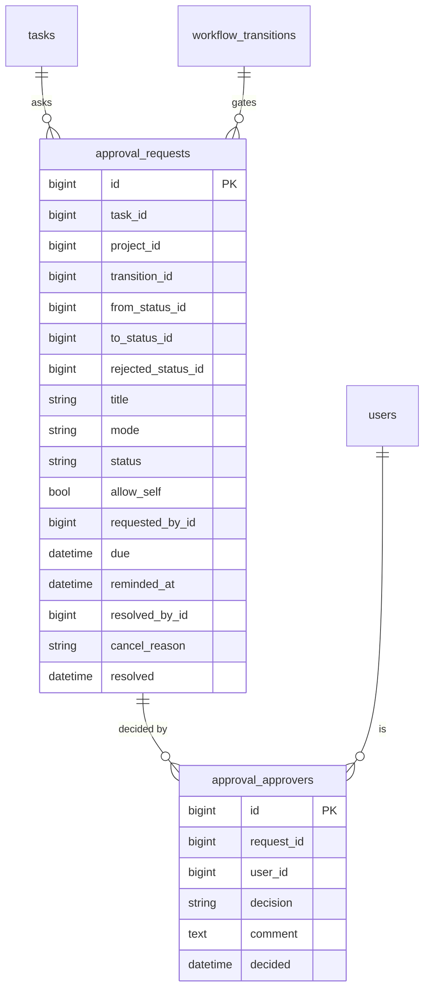

# Approvals

Explicit, recorded decisions by named people: a workflow transition can require approval, and any task can get an ad-hoc approval request.

Design document and history: the "Approvals" part of [docs/enterprise/forms-approvals.md](../enterprise/forms-approvals.md). Workflows, which approvals plug into: [workflows](workflows.md). API conventions: [API.md](../../API.md). Module index: [README.md](README.md).

## Overview

"This cannot go to print until the editor in chief approves" is a rule about people, not about a status anyone with write access can set. Approvals add that rule to workflows: a transition marked `requires_approval` does not move the task; it creates a request, asks the configured approvers, and performs the transition on behalf of the requester only when the approvers have decided. The decision, who made it and the comment are recorded. Ad-hoc approvals record a decision on a task without any status change.

Audience: project admins configure which transitions need approval and who approves; members request and decide; operators should know that approvals are tied to workflows and that link shares have no access.

## Concepts

- **Request** (`approval_requests`): a task, an optional transition with its `from`, `to` and `rejected` statuses (all empty for ad-hoc requests), a title, description, the comment sent with the status change, a `mode`, a `status` (`pending`, `approved`, `rejected`, `cancelled`), `allow_self`, the requester, an optional `due`, `reminded_at`, who resolved it (0 when the system did), and a machine-readable `cancel_reason` with a human `cancel_message`.
- **Approver** (`approval_approvers`): a user with a `decision` (empty, `approved`, `rejected`), a comment and a time. Unique per (request, user).
- **Mode.** `any`: the first decision resolves the request. `all`: every approver has to approve, and one rejection rejects at once.
- **Approver sources** on a transition: `user` (an active user who can read the project), `team` (a team the project is shared with, expanded to its members when the request is created), `assignees` (the task's assignees) and `custom_field` (a `user` field of the project, "the editor named on the task"). They are resolved to concrete users when the request is created, in order of the sources, de-duplicated, only active users who can read the task, and without the requester unless `allow_self` is set. Nobody left: no request is created and the caller gets `422` / `24006`.
- **Transition configuration**: `requires_approval` plus an `approval` object `{mode, approvers, rejected_status_id, allow_self, due_in}`. Validation (`400` / `21002`): `approval` is required when `requires_approval` is set and dropped when it is not; at least one and at most 50 sources; `rejected_status_id` belongs to the document, is not archived and is not the target; `due_in` is a positive duration such as `12h`, `3d` or `2w`.

### Behaviour

- **Requesting.** A transition with `requires_approval` runs every other check first (target exists, pair allowed, permission and team, required fields, required comment). It then creates the pending request and returns it. Asking again for the same task and target returns the existing request (no duplicate, no new notification); a pending request for a different target on the same task is allowed. Even a project admin asks. Link shares cannot (`403` / `24010`).
- **Deciding.** `POST /approvals/{request}/decision`. Only an approver who has not decided can; a rejection needs a comment (`24005`). Approvers who lost read access to the project are dropped first and no longer count. A disabled account cannot decide and is never asked. Disabling an account (admin route or CLI, `ChangeUserStatus`), disabling a bot, and disabling the owner of a bot (the bot stays active but cannot authenticate any more) drop the account, or the bots of the owner, from the undecided slots of every pending request, like deleting it does: a request that was waiting only for it ends as `no_approvers`, one where everybody left has approved is approved. This runs **after** the status change has committed, in a transaction of its own (an event hook registers it with `events.OnCommit`, so no upstream code calls into the approvals), and a failure is logged and never undoes or blocks the disabling: until it has run the slots still exist, which is safe because a disabled account cannot decide and the next decision on the request drops it. The requests are walked in the order of their tasks, so two accounts disabled or deleted at the same time do not deadlock. An approver who is only locked out by failed logins (`StatusAccountLocked`, which anybody can cause) keeps the slot; otherwise ten bad logins would remove the dissenting approver of an `all` request and let the others decide without them. Enabling the account again does not bring dropped slots back; a decision an approver already made stays.
- **Approved.** The system performs the transition on behalf of the requester; every check except the approval requirement runs again at that moment. History shows the requester as doer with the request's comment and id. If something no longer holds, or the requester's account is disabled at that moment (`requester_disabled`; the requests of a disabled requester stay pending until then, the account may be enabled again, and a requester who is a bot counts as disabled when its owner is). Only a disabled account blocks the transition: a login lockout does not, because it is temporary, anybody can cause it, and the request was made while the requester could act, the request becomes `cancelled` (decisions stay, the status does not change) with a `cancel_reason`, and the decision still answers `200` with the request saying what happened.
- **Rejected.** The task stays, or moves to `rejected_status_id` as a system transition (rules bypassed; the history names the rejecting approver; skipped when the task left the `from` status or the status is gone). The comment is added to the task as a comment authored by the approver.
- **Cancelling.** `POST /approvals/{request}/cancel` by the requester or a project admin (`cancelled_by_requester`).
- **Cancel reasons.** `cancelled_by_requester`, `task_deleted`, `task_moved`, `workflow_removed`, `status_removed`, `transition_removed`, `approval_disabled`, `status_changed` (the task left the `from` status by another route; ad-hoc requests are not tied to a status), `target_archived`, `requirements_not_met`, `requester_lost_access`, `requester_not_in_team`, `requester_deleted`, `requester_disabled`, `no_approvers`.
- **Ad-hoc approvals.** `POST /tasks/{task}/approvals` needs a title and `approver_ids` (users who can read the task; the requester cannot be one); `mode` defaults to `any`; `due` is optional.
- **Concurrency.** Every decision and cancellation first takes the write lock of the request (a no-op `UPDATE` of its row) and then uses locking reads; resolving, cancelling and approving are conditional updates on `status = pending` inside the transaction of the transition. Two approvers deciding at once, or a decision racing a cancel, are serialized and the loser gets `409` / `24002`. Creating a request takes the lock of the task row.

### What each caller of the status change does

| Caller | When the transition needs approval |
|---|---|
| `POST /tasks/{task}/status` | `202` with the pending request in `approval`; `200` when the status changed |
| Done checkbox (`PUT /tasks/{task}` with `done`), kanban moves into a done bucket of a manual view, bulk updates | Refused with `409` / `24007`; the whole update is rolled back and **no request is created**. `details` carry `task_id`, the from and to statuses (id and title), `to_status_category`, `pending_approval_id`, `approval_pending` and `requestable` (true: the client may ask with `POST /tasks/{task}/status`) |
| A task created done, or a done task moved in from another project | Refused like the checkbox with `requestable: false` (the creation or move is rolled back as a whole), nothing is created or moved |
| Kanban status-mode move | The request is created, the card does not move, `202` with `approval` |
| Task created in a status column | Created in the initial status; the request for the column is created |
| Automation `task.set_status`, script `vikunja.status.set` | Creates the request as the rule owner; the step succeeds with the output `approval requested (#id)`; nobody to ask fails the step (`24006`) |
| Automation `task.set_done`, `vikunja.tasks.update({done})` | Like the checkbox: the step fails with `24007` |
| Re-opening a repeating task, the move after a rejection, assigning the first status, moving the tasks of a removed status | System transitions: never create approvals |

## Data model

Tables and the extra columns on `workflow_transitions` (`requires_approval`, `approval`) and `task_status_history` (`approval_request_id`) are created by `pkg/migration/20261124100000.go`. `approval_requests.task_id`, `project_id`, `status` and `requested_by_id` are indexed; `approval_approvers` has a unique (request, user) pair. `transition_id` and the status ids are null for ad-hoc requests.

## Permissions

| Action | Needs |
|---|---|
| List "my approvals" | a signed-in user; only requests where the caller is approver or requester and can still read the task (in the project the task is in now) |
| Read a request | read on the task |
| Decide | read on the task, and being an approver of the request who has not decided (`24003` otherwise; `24004` when already decided; `24008` when the requester may not decide) |
| Cancel | the requester or a project admin |
| Request an ad-hoc approval | write on the task |
| Request through a transition | whatever the transition needs; even admins ask |

**Link shares have no access to approvals at all**: `403` on every route, no `approvals` expand, no approval data in the task status. A request of a task the caller cannot read answers `404` (`24001`) on decision and cancel and `403` on read. Permission methods are in `pkg/models/approvals_permissions.go`. API token groups: `approvals` and `tasks_approvals`; `expand=approvals` needs `tasks_approvals` `read_all`.

## API

All routes are on `/api/v2`; conventions are in [API.md](../../API.md).

| Method | Path | Operation ID | Permission | Description |
|---|---|---|---|---|
| GET | `/approvals` | `approvals-list` | signed-in user (own requests only) | List my approvals |
| GET | `/approvals/{request}` | `approvals-read` | read on task (no link shares) | Get an approval request |
| POST | `/approvals/{request}/decision` | `approvals-decide` | an approver who has not decided | Decide on an approval request |
| POST | `/approvals/{request}/cancel` | `approvals-cancel` | the requester or project admin | Cancel an approval request |
| GET | `/tasks/{task}/approvals` | `task-approvals-list` | read on task (no link shares) | List the approval requests of a task |
| POST | `/tasks/{task}/approvals` | `task-approvals-create` | write on task (no link shares) | Request an approval for a task |

`GET /approvals` takes `status`, `role` (`approver` or `requester`), `project_id`, `page` and `per_page`; each item carries the approvers, the statuses and a compact `task`. `GET /tasks/{task}/status` additionally returns `pending_approvals` and, per offered transition, `requires_approval`, `approval_mode` and `approvers`. Task lists accept `expand=approvals`: every task gets `approvals: {has_pending, pending_count}` (one query per page). Worked requests and responses are in [API.md](../../API.md#examples).

Error codes: `24001` request not found (404), `24002` not pending (409), `24003` not an approver (403), `24004` already decided (409), `24005` rejection without comment (422), `24006` no approvers (422), `24007` approval required for a done change (409), `24008` requester may not decide (403), `24009` invalid ad-hoc request (400), `24010` link share cannot request (403).

## Configuration keys

None. The reminder job runs every five minutes (`*/5 * * * *`, registered by `RegisterApprovalReminderCron`) and is not configurable.

## UI

- **Workflow editor**: an "Approval" section on a transition (mode, approver sources, status after rejection, duration, self-approval); transitions with approval carry a tag in the list and an icon in the matrix.
- **Task detail**: an approval banner (who is asked, who decided what, due) with approve and reject for approvers and cancel for the requester and admins; resolved requests in a collapsible section; the status menu labels such transitions "Request approval"; "Request approval" in the actions menu opens the ad-hoc dialog.
- **Markers** on kanban cards, list rows and the table status cell ("Waiting for approval").
- **Approvals page** (`/approvals`, sidebar entry with a count badge): waiting for me, requested by me, history.
- **Refused done**: the checkbox is rolled back and a message names the status with the action "Request approval" (or offers to open the task when a request is pending).

More in [DESIGN.md](../../DESIGN.md#approvals).

## Events and interaction with other modules

- **Events** (dispatched on commit): `approval.requested`, `approval.decided` (per decision), `approval.resolved` (outcome `approved`, `rejected` or `cancelled`; the doer is empty when the system ended it). Requests that were only returned again announce nothing.
- **Notifications** (in-app, plus e-mail when the mailer is on): `approval.requested` to every approver; `approval.resolved` to the requester and to the approvers who did not decide; `approval.reminder` once to undecided approvers after `due`.
- **Automation**: triggers `approval.requested` and `approval.resolved` (option `outcome`: `any`, `approved`, `rejected`, `cancelled`), condition fields `event.new.approval_id`, `approval_title`, `approval_mode`, `ad_hoc`, `requested_by`, `approvers`, `outcome`, `cancel_reason`, `event.old.status` and `event.new.status`, placeholders `{{event.approval.id}}`, `{{event.approval.title}}`, `{{event.approval.outcome}}`, and the ad-hoc action `approval.request` (the owner of the rule asks and is never an approver) ([automation](automation.md)).
- **Workflows**: see [workflows](workflows.md). **Custom fields**: a `user` field can be an approver source ([custom fields](custom-fields.md)).

## Limits and safety

- At most 50 approver sources per transition.
- A request is created for at most the approvers who can read the task; a request cannot be created with nobody to decide.
- Concurrency is serialized by the lock on the request row; the loser of a race gets `409`.
- Locks are always taken in the same order: the task row, then the request row. A direct status change of the task locks the task first, so a decision or a cancellation of one of its requests does the same; the opposite order deadlocked on PostgreSQL (`40P01`) and MySQL (`1213`). `TestApprovals_DecisionAndStatusChangeDoNotDeadlock` covers it on PostgreSQL 18 and MySQL 8 (it is skipped on SQLite).
- Approved transitions are re-checked at approval time, so a stale request cannot bypass a rule that changed meanwhile.

## Known gaps and open decisions

From the [roadmap](../enterprise/ROADMAP.md):

- An approved transition is performed for a requester whose account was disabled; a request whose only approver was disabled stays pending.
- Approvers' Turkish backend strings are not added; other languages come from Crowdin.
- Not exercised in a browser: an overdue request, the reminder notification and the table marker.
- Not exposed over MCP.
- Plain `done: true` updates from a list checkbox still answer `409`; the client handles it by rolling back and offering "Request approval".
- Which databases the approvals tests have been run on is recorded in the roadmap.

## Where the code lives

| What | Where |
|---|---|
| Requests, modes, approvers, document types | `pkg/models/approvals.go` |
| Decisions and cancellation | `pkg/models/approvals_decisions.go`, `pkg/models/approvals_lifecycle.go` |
| Workflow integration | `pkg/models/approvals_workflow.go` |
| Expand | `pkg/models/approvals_expand.go` |
| Notifications and reminders | `pkg/models/approvals_notifications.go` |
| Permissions, events | `pkg/models/approvals_permissions.go`, `pkg/models/approval_events.go` |
| Errors | `pkg/models/error_approvals.go` (`24001` to `24010`) |
| Routes | `pkg/routes/api/v2/approvals.go` |
| Migration | `pkg/migration/20261124100000.go` |
| Tests | `pkg/models/approvals_test.go`, `pkg/models/approvals_decisions_test.go`, `pkg/models/approvals_flows_test.go`, `pkg/models/approvals_notifications_test.go`, `pkg/automation/approvals_test.go`, `pkg/automation/approvals_concurrency_test.go`, `pkg/webtests/huma_approvals_test.go` |
| Frontend | `frontend/src/components/approvals/`, `frontend/src/views/approvals/`, `frontend/src/client/queries/approvals.ts`, `frontend/src/helpers/approvals.ts` |
