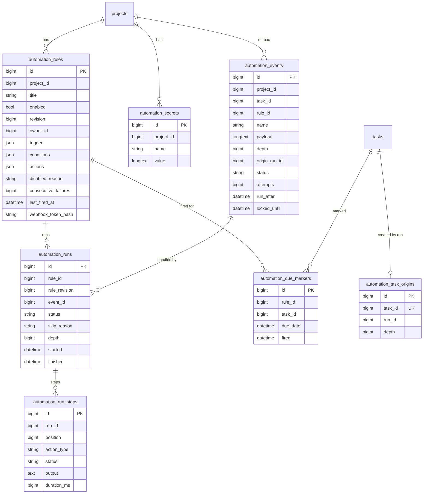

# Automation

Rules of the form **When** (trigger) **If** (conditions) **Then** (actions), run by a database outbox and workers inside the Vikunja process, with sandboxed scripting, signed outbound HTTP, encrypted project secrets, a dry run and a run history.

Design document and history: [docs/enterprise/automation.md](../enterprise/automation.md). Architecture of the engine (outbox, claiming, ticker, loop guards, with diagrams): [ARCHITECTURE.md](../../ARCHITECTURE.md#events-and-the-automation-engine). API conventions: [API.md](../../API.md). Module index: [README.md](README.md).

## Overview

Repetitive project hygiene ("when a task is created with urgent in the title set priority 5", "when the last subtask is done close the parent", "every Monday create the weekly checklist", "tell the chat when a request arrives from our website") should not need a person or a custom integration. Project admins describe rules in a visual editor; when the building blocks are not enough, an action or condition can be a script. Everything a rule does is recorded: every run, every step, its result, error and duration.

Audience: project admins write rules; operators decide whether scripts are allowed and tune the limits; contributors extend the catalog.

The engine is still one process: no Redis, no worker container. Delivery is **at least once**, and every step is idempotent per (event, rule, position), so a retry never performs a step twice.

## Concepts

- **Rule** (`automation_rules`): a project, a title, `enabled`, a `revision` that increases on every change, an **owner**, a `trigger`, optional `conditions` and a list of `actions`. A rule runs **as its owner**: the user who saves a rule becomes its owner, so nobody can borrow the permissions of another admin by editing their rule. Actions can never do more than the owner could do by hand. Creating or changing a rule, and reading rules and runs, needs project admin.
- **Disabled reasons.** If the owner loses admin on the project or can no longer log in, the rule is disabled with `owner_not_admin` or `owner_unavailable`. The system also disables a rule that failed `automation.maxconsecutivefailures` runs in a row (`too_many_failures`), one whose custom field or status was deleted (`custom_field_deleted`, `status_deleted`), the copy of a duplicated project (`duplicated`, `duplicated_unmapped_reference`, and `duplicated_secrets_missing` when it uses secrets). Saving the rule by hand clears the reason.
- **Event** (`automation_events`): the outbox row. Model events of a project (`task.created`, ...) are written in the same transaction as the change; time, manual, webhook and resume events are written for **one rule** (`rule_id`). Status `pending`, `processing`, `done` or `dead`.
- **Run** (`automation_runs`): one rule handling one event. Status `running` (also while waiting for a retry or a wait), `success`, `failed`, `skipped` (a limit or the conditions stopped it, see `skip_reason`) or `aborted` (the owner may no longer run the rule, or the rule changed under a resumed run).
- **Step** (`automation_run_steps`): one action of a run, with status, error, output (cut to 16 KiB) and duration.
- **Catalog**: the machine-readable list of triggers, condition fields, operators and actions with parameter schemas, served by `GET /api/v2/automations/catalog`. The visual editor is generated from it.
- **Skip reasons**: `max_depth`, `self_trigger`, `rate_limit`, `conditions_not_met`, `task_not_found`, `rule_disabled`, `owner_not_admin`, `owner_unavailable`, `too_many_actions`, `rule_changed`.

### The rule document

```json
{
  "title": "Urgent first",
  "enabled": true,
  "trigger": {"type": "task.created"},
  "conditions": {"field": "title", "op": "like", "value": "urgent"},
  "actions": [{"type": "task.set_field", "params": {"field": "priority", "value": 5}}]
}
```

An invalid rule is `400` / `22002` with `details.issues`, a list of `{path, message}` (`actions[1].params.status_id`, ...); a script that does not compile is reported with its path and the `line` and `column` of the syntax error.

## Triggers

Nineteen trigger types. "Event" is the engine event the trigger listens to.

| Type | Event | Options | Notes |
|---|---|---|---|
| `task.created` | `task.created` | none | |
| `task.updated` | `task.updated` | `fields` (list of task fields) | Only when one of the listed fields changed; needs the old state, which task-model updates carry |
| `task.completed` | `task.updated` | none | The done flag changed to true |
| `task.reopened` | `task.updated` | none | The done flag changed to false |
| `task.deleted` | `task.deleted` | none | Runs after the task is gone; conditions and templates see the task as it was; actions that need the task fail |
| `task.status_changed` | `task.status.changed` | `from_status_id`, `to_status_id`, `to_category` | |
| `task.custom_field_changed` | `task.custom-field-value.updated` | `field_id` | |
| `task.assignee_added` | `task.assignee.created` | none | |
| `task.assignee_removed` | `task.assignee.deleted` | none | |
| `task.comment_added` | `task.comment.created` | none | |
| `task.attachment_added` | `task.attachment.created` | none | |
| `approval.requested` | `approval.requested` | none | |
| `approval.resolved` | `approval.resolved` | `outcome` (`any`, `approved`, `rejected`, `cancelled`) | |
| `form.submitted` | `form.submitted` | `form_id` | |
| `manual` | `rule.manual` | `label` (button text) | A button "Run automation..." on a task |
| `schedule` | `rule.schedule` | `cron` (required), `scope` (`tasks` or `project`) | See [Ticker semantics](#ticker-semantics) |
| `task.overdue` | `rule.overdue` | none | |
| `task.due_soon` | `rule.due_soon` | `offset` (duration, at least 1m) | |
| `webhook.incoming` | `rule.webhook` | `secret` (name of a project secret) | See [Incoming webhook](#incoming-webhook) |

Changes that produce a `task.updated` without an old state (label changes, assignee changes, kanban moves to a done bucket) match `task.updated` but never `task.completed`, `task.reopened` or a `fields` filter. The task of an event is handed to a rule only while the owner can read it; a task moved to a project the owner cannot see is treated as gone (`task_not_found`).

## Conditions

A tree of `all`, `any` and `not` groups over comparisons `{field, op, value}`, or a script `{script}`. `not` is true when none of its children holds. Conditions are evaluated in memory over a normalized snapshot of the task as it is when the rule runs, once, before the first action; a resumed run does not evaluate them again.

- **Operators**: `=`, `!=`, `>`, `>=`, `<`, `<=`, `like`, `in`, `not in`, `is_empty`, `is_not_empty`. Dates accept RFC 3339, plain dates and `now`, `now+3d`, `now-12h`. `like` is case-insensitive, `%` is a wildcard, and without one it is a substring match; `=` and `in` are case-sensitive. For lists (assignees, labels, multi select and user fields) `=` and `in` mean "contains", `!=` and `not in` "contains none". `is_empty` is null, empty text or an empty list. The keywords `event_doer` and `task_creator` can be used as values of user fields.
- **Fields**: `title`, `description`, `done`, `priority`, `percent_done`, `due_date`, `start_date`, `end_date`, `done_at`, `created`, `updated`, `hex_color`, `identifier`, `project_id`, `created_by`, `assignees`, `labels`, `status`, `status_category`, `cf_<id>`, `event.doer.id`, `event.doer.username`, `event.doer.name`, `event.old.<key>` and `event.new.<key>` (the old and new value the event knows: the task fields for updates, `status` and `status_category` for status changes, `value` for custom field changes, `assignee`, `comment`, `attachment_name`, the approval fields `approval_id`, `approval_title`, `approval_mode`, `ad_hoc`, `requested_by`, `approvers`, `outcome`, `cancel_reason`, and the form fields `form_id`, `form_title`, `submitter_name`, `submitter_email`), and `event.payload.<path>` for incoming webhooks. `GET /automations/catalog` lists them with the operators of each; with `project_id` the custom fields of the project are added.
- **Script conditions** `{"script": "..."}` return a boolean; see [Scripts](#scripts).

## Actions

Nineteen action types. Text parameters marked "template" accept the placeholders listed below the table.

| Type | Parameters | Notes |
|---|---|---|
| `task.set_field` | `field` (`title`, `description`, `priority`, `due_date`, `start_date`, `end_date`, `percent_done`, `hex_color`), `value` | Dates are absolute or relative (`+3d`, `none`) to now, not to the current value |
| `task.set_custom_field` | `field_id`, `value` | Same validation as the API |
| `task.set_done` | `done` | Refused (`24007`) when the done transition needs approval |
| `task.set_status` | `status_id`, `comment` (template) | Through the normal transition checks as the owner; a transition that needs approval creates the request and the step succeeds with `approval requested (#id)` |
| `task.assign`, `task.unassign` | `user` (a user id, `event_doer` or `task_creator`) | A no-op succeeds with "nothing to do" and causes no event |
| `task.add_label`, `task.remove_label` | `label_id` | |
| `task.add_comment` | `text` (template) | Escaped and wrapped in paragraphs |
| `task.create_subtask` | `title` (template), `description` (template), `assignee`, `due_offset` | |
| `task.create_related` | `title`, `description`, `assignee`, `due_offset`, `relation_kind` (`related`, `blocking`, `blocked`, `precedes`, `follows`, `duplicates`, `duplicateof`) | |
| `task.move` | `project_id` | |
| `flow.stop_if` | `condition` | Ends the run when the condition holds |
| `script.run` | `source` (JavaScript) | See [Scripts](#scripts) |
| `http.request` | `url` (template), `method` (default `POST`), `headers` (map of templates), `body` (template), `secret` | See [HTTP](#http-httprequest-and-httpfetch) |
| `approval.request` | `approvers` (user ids, `assignees`, `task_creator`, `event_doer`), `mode`, `title`, `description`, `due_offset` | Ad hoc; the owner asks and is never an approver |
| `task.create` | `title`, `description`, `priority`, `assignee`, `due_offset` | Creates a task in the project as the owner; with no task in the run (webhook, project-scope schedule) it becomes the task of the actions after it |
| `wait` | `duration` (at least 1 minute, at most `automation.waitmax`) | Stored as a scheduled event, not a sleeping goroutine |
| `notify` | `recipients` (user ids, `event_doer`, `task_creator`, `assignees`), `team_id`, `message` (template) | In-app notification (and e-mail per the person's settings) to people who can read the project, at most 100 per step; the step fails when nobody is left |

Not implemented: an e-mail action, label, relation, move and reminder triggers, round robin, and duplicate or delete task actions.

**Templates.** `{{task.title}}`, `{{task.id}}`, `{{task.identifier}}`, `{{task.description}}`, `{{task.cf.12}}`, `{{event.doer.name}}`, `{{event.doer.username}}`, `{{project.title}}`, `{{event.approval.id}}`, `{{event.approval.title}}`, `{{event.approval.outcome}}`, `{{event.form.title}}`, `{{event.form.submitter_name}}`, `{{event.form.submitter_email}}` and `{{event.payload.<path>}}`. A template is plain substitution: no logic, no code. Unknown placeholders render empty and are reported as warnings in the dry run and in the step output. Select custom fields render the option title. `{{secrets.NAME}}` is allowed **only** in `http.request` header values and body.

**Plan and apply.** Every action exists as a *plan* (reads, checks, resolves templates; used by the dry run) and an *apply* (writes); a real run is plan followed by apply in one transaction per step.

## Scripts

Scripts run in an embedded, pure-Go JavaScript interpreter (goja: ECMAScript 5.1 and most of ES6; promises exist but there is no event loop). Every run gets a fresh interpreter. There is no `require`, file system, process, environment or timers, and no network except `http.fetch`.

- **Script action**: `{"type": "script.run", "params": {"source": "..."}}`. The source is the body of a function in strict mode; `return` gives a result stored as JSON in the step output. A thrown error fails the step; the text carries the stack with line and column.
- **Script condition**: `{"script": "..."}`, same convention; the result is converted to true or false. A script that returns nothing fails the run ("end it with `return true` or `return false`"). Condition scripts always get a **read-only** API and a shorter timeout.

**Globals** (frozen, plain objects):

| Name | Content |
|---|---|
| `event` | `{name, task_id, project_id, doer: {id, username, name}, old, new, changed, field_id}` |
| `task` | The task as it is when the script starts: `id`, `title`, `description`, `done`, `priority`, `percent_done`, `due_date`, `start_date`, `end_date`, `done_at`, `created`, `updated`, `hex_color`, `identifier`, `project_id`, `created_by`, `assignees`, `labels`, `status`, `custom_fields`, `relations`. `null` for `task.deleted` |
| `project` | `{id, title}` |

**Functions**:

| Signature | Mutating | In a condition |
|---|---|---|
| `vikunja.tasks.get(id)` | no | yes |
| `vikunja.tasks.find(filter, options?)` | no | yes |
| `vikunja.tasks.update(id, patch)` | yes | no |
| `vikunja.tasks.create(projectId, data)` | yes | no |
| `vikunja.tasks.comment(id, text)` | yes | no |
| `vikunja.fields.get(taskId, fieldId)` | no | yes |
| `vikunja.fields.set(taskId, fieldId, value)` | yes | no |
| `vikunja.status.set(taskId, statusId, comment?)` | yes | no |
| `vikunja.assignees.add(taskId, userId)`, `.remove(...)` | yes | no |
| `vikunja.labels.add(taskId, labelId)`, `.remove(...)` | yes | no |
| `http.fetch(url, {method?, headers?, body?, timeout?})` | yes | no |
| `secrets.get(name)` | no | no |
| `log(...args)` (`console.log` is the same) | no | yes |

Every `vikunja.*` call runs through the same model functions and permission checks the built-in actions use, **as the rule owner**, in the transaction of the step; events they cause carry the origin run and depth like those of any action, so the depth limit and the self-trigger guard apply. Text passed to `vikunja.*` is data: placeholders are not replaced. Errors surface as thrown `Error`s that can be caught. A failing script is a failure of the rule and is not retried; a temporary failure (a cancelled step timeout, a database error) is retried. A database error inside a script should not be caught and ignored: on PostgreSQL the transaction of the step is unusable after it. The full API reference, with limits, is in the catalog (`script` object) and in the editor's help panel.

Example, summing a number field over subtasks into the parent when a subtask reaches a done status (trigger `task.status_changed` with `to_category: done`):

```js
const FIELD = 12;
const parentId = (task.relations.parenttask || [])[0];
if (!parentId) return "no parent";
let sum = 0;
for (const id of vikunja.tasks.get(parentId).relations.subtask || []) {
  const value = vikunja.fields.get(id, FIELD);
  if (typeof value === "number") sum += value;
}
vikunja.fields.set(parentId, FIELD, sum);
return {parent: parentId, sum: sum};
```

**What a script can reach**: only what the owner could do by hand, plus public HTTP destinations through the SSRF guard, plus the secrets of its own project. Nothing handed to the interpreter is a wrapped Go value. **What is not protected**: CPU and memory up to the limits (one core for the script timeout plus half a second, and `automation.scripts.maxmemory`, per script, times `automation.workers` plus concurrent test runs), database locks (a script runs inside the step's transaction, which on SQLite holds the write lock while waiting for the network), and external effects (not rolled back if the step fails afterwards, delivered at least once). Secrets are protected from display, not from the script author: a project admin who can write scripts can make a script send a secret to a server of their choice. That is why writing scripts needs project admin and why `automation.scripts.enabled` exists. When it is `false`, rules with scripts cannot be saved (`400` / `22005`) and existing ones fail their step without executing anything; `http.request` is not a script and is unaffected.

## HTTP (`http.request` and `http.fetch`)

Both use one code path (`pkg/automation/outbound`) and the SSRF-protected client of user webhooks: requests to loopback, private, link-local and cloud-metadata addresses, and to anything not globally routable, are refused unless `outgoingrequests.allownonroutableips` is set; `outgoingrequests.proxyurl` is honoured. The check is made when the connection is **dialled**, not on a pre-resolved name, so DNS rebinding does not help, and it runs again for every redirect. Only `http` and `https`; at most 3 redirects, and a redirect to another host drops the headers the rule set; no credentials in the URL; the default `User-Agent` is `Vikunja-Automation`; no Vikunja credential is ever sent. The duration is the request's own, capped by `automation.scripts.httptimeout`; response bodies are read up to `automation.scripts.maxresponsesize` and request bodies larger than that are refused.

`http.request` header values and body are templates (`Host`, `Content-Length`, `Transfer-Encoding`, `Connection` and `Upgrade` cannot be set; placeholder values in the URL are URL-escaped). With `secret` set, the request carries `X-Vikunja-Signature: sha256=<hex HMAC-SHA256 of the exact body, keyed with the secret>`. Without a `Content-Type` header the body is sent as `application/json` when it is valid JSON, otherwise `text/plain`. The step output is `METHOD url: status text` plus the first 2 KiB of the answer, with secrets masked.

**Retry semantics**: a network error, a timeout or a `5xx` answer is a temporary failure (retried with backoff up to `automation.maxattempts`); a `4xx` answer, a refused address, an invalid URL or header fail the run at once. The call happens inside the step's transaction, so it is delivered **at least once**: when the commit fails after the request went out, the retry sends it again. Every request carries the loop-guard header `X-Vikunja-Automation-Depth` (see [Loop guards](#loop-guards)); `http.request` also refuses URLs that look like this server's webhook endpoints.

Example (`CHAT_TOKEN` and `CHAT_SIGNING_KEY` are project secrets):

```json
{"type": "http.request", "params": {
  "url": "https://chat.example.com/hooks/vikunja",
  "method": "POST",
  "headers": {"Authorization": "Bearer {{secrets.CHAT_TOKEN}}"},
  "body": "{\"text\": \"{{event.doer.name}} created {{task.identifier}}: {{task.title}}\"}",
  "secret": "CHAT_SIGNING_KEY"
}}
```

## Secrets

Project secrets (`automation_secrets`) are named values (`^[A-Za-z_][A-Za-z0-9_]{0,63}$`, at most 8 KiB) that rules use without them being shown anywhere. They are managed with API v2 by project admins only. There is no endpoint that returns a value; the list shows names, timestamps and `unreadable`.

- **At rest**: AES-256-GCM, key derived with HKDF-SHA256 from `service.secret`, a random 96-bit nonce per value, the project id and name authenticated as additional data, and a `v1:` version prefix. If `service.secret` changes, values cannot be decrypted: the list shows `unreadable: true`, `secrets.get` throws, and setting the secret again fixes it. Vikunja generates a random `service.secret` at every start when none is configured, so **set `service.secret` explicitly**.
- **Where they can be used**: `secrets.get(name)` in scripts (not in condition scripts), and `{{secrets.NAME}}` only in `http.request` header values and body, plus the `secret` parameter and the webhook trigger's `secret` option. A rule that uses `{{secrets.NAME}}` elsewhere, or names a secret that does not exist in the project, is rejected when saved.
- **Masking**: before anything is stored (step output and error, run error, the last error of the event, the dry-run result) the engine replaces every secret value the step read and every other readable secret value of the project (values shorter than 4 characters only when the step read them) by `***`, in plain, URL-encoded, base64 and JSON-escaped form.
- **Lifecycle**: purging a project deletes its secrets; duplicating a project copies none, so the copied rules stay disabled until the secrets exist.

## Dry run

`POST /projects/{project}/automations/{rule}/test` with `{"task_id": ...}` (and an optional `payload` for webhook rules) runs a saved rule against a task of the project **without writing anything**: it evaluates the conditions, plans every action as the owner (rendering templates, checking permissions and workflow transitions) and returns the plan, warnings and what would fail. The event is simulated (you are the doer, `event.old.*` and `event.new.*` are empty). Scripts run with a recording, read-only host: reads work against the real data; every mutating call is checked exactly like a real call and then only recorded (`would call vikunja.tasks.update(12, {"priority":5}): set priority to 5`); `http.fetch` is recorded and returns a stub; `secrets.get` checks that the secret exists and returns `[secret NAME]`, never the value. This is structural: the runner builds one of three implementations of the same host interface (live, dry, read-only) and a script cannot choose.

## Runs, retry and history

- `GET .../runs` lists the runs of a rule newest first; `GET .../runs/{run}` returns one with its steps.
- A run that is `failed` can be retried: `POST .../runs/{run}/retry` puts its event back in the queue; steps that succeeded are not executed again and the run resumes at the first step that did not (`22004` for other statuses). Retrying one failed run re-queues the whole event, so rules created after the event run for it too.
- A resumed run first checks that the steps it recorded still are the actions at their positions; if the rule was edited so they are not, the run is `aborted` with `rule_changed`. Editing the action that failed and retrying works.
- A failure that will happen again (a permission or workflow rejection, an invalid value, a vanished task) fails the run at once. Anything else leaves the run `running` and the event goes back to `pending` with exponential backoff (10 s, 20 s, 40 s, ...) until `automation.maxattempts`, then the event is `dead` and the run `failed`.
- Finished events, runs and steps are deleted by a daily job at 03:17 server time (`automation.retention` days, `0` keeps everything). Runs that are still running are never deleted; runs that wait longer than their waits plus a day are failed by the same job.
- Prometheus metrics `vikunja_automation_runs_total{status}` and `vikunja_automation_events{status}` exist when `metrics.enabled` is on.

## Ticker semantics

Every process runs the ticker every `automation.ticker.interval`. It reads only while nothing is due. A firing is claimed in the database in the same transaction that writes the events, so several instances never fire twice. Per tick and rule at most `automation.ticker.maxtasks` runs start and a schedule looks at no more than `automation.ticker.maxscan` tasks; the per-minute run limit does not apply to these triggers, the cap does.

- **Schedule.** `cron` is a five-field expression or `@hourly`, `@daily`, `@weekly`, `@monthly`, `@yearly`, evaluated in the **time zone of the server** (`service.timezone`) on wall-clock time. `@every ...` and `TZ=` or `CRON_TZ=` prefixes are rejected. `scope: tasks` (default) starts one run per task of the project that matches the conditions; `scope: project` starts one run with no task (use `task.create` first). Nothing fires for the time before the rule was last saved, and a server that was down fires once for all the occurrences it missed. A wall-clock time that does not exist (the clocks jump forward) is skipped that day; one that happens twice fires once, for the first. When the day of the month and the day of the week are both restricted, a day matches when **either** does. A schedule that never happens (30 February) is rejected on save. A schedule claims its occurrence with a conditional update of `last_fired_at`, and when more tasks match than the cap allows the rest is skipped and the note is stored on the rule as `last_fire_note`.
- **Overdue and due soon.** Fire for tasks that are not done, the first time they cross the line. A marker per (rule, task) in `automation_due_markers` stores the due date it fired for, so a task fires once per due date and a changed due date arms it again; the unique index is the claim.
- **Arming.** A rule is armed when it is created, enabled again, or gets another trigger (type or options). Arming writes a marker for every task of the project that is already overdue (or inside the due-soon window), at most 20000, in the transaction of the save, so those tasks do not fire. Editing the title, conditions or actions does not re-arm. A task created with a due date in the past fires overdue. Conditions are checked before a run is queued (script conditions only in the run); a non-matching task is marked too.
- **Owner check.** For schedule and due rules the owner is checked when the ticker is about to fire: an owner who is gone or no longer administers the project disables the rule instead.
- **Wait.** The run stays `running` and a `rule.resume` event due after the delay continues it with the actions after the wait; conditions are not evaluated again; a disabled or deleted rule aborts the run. Only the resume event continues past a wait. A project can have `automation.maxpendingwaits` runs waiting; the cap is soft because it is checked without a lock.

## Incoming webhook

`POST /api/v2/automation/hooks/{token}` with a JSON object (`{}` for none; at most `automation.webhook.maxbody` bytes) starts the rule asynchronously (`202`). The body is `event.payload`. The token is 32 random bytes (base64url), returned once in the answer that created or regenerated it (`webhook_token`, `webhook_url`); the database stores only its SHA-256 and looks it up by that hash after a shape check; it is never logged. Unknown tokens, disabled rules and rules with another trigger are the same `404`. With a `secret` option the call must carry `X-Vikunja-Signature: sha256=<hex HMAC-SHA256 of the raw body>` (`401` otherwise, constant-time, checked before the rate limit counts). Calls are limited per rule (`automation.webhook.ratelimit` per minute, `429` with `Retry-After`) and per IP by the router. The route sets no cookies and needs no CSRF token.

**There is no replay protection**: the signature covers the body only, without a timestamp or nonce, so a captured request can be replayed until the secret or the address changes. Rotate the address with `POST .../webhook-token`, and put a verifying proxy in front where more is needed.

## Limits and safety

| Limit | Default | Key |
|---|---|---|
| Kill switch for the whole instance | on | `automation.enabled` |
| Kill switch for scripts | on | `automation.scripts.enabled` |
| Chain depth | 3 | `automation.maxdepth` |
| Actions per rule and run | 25 | `automation.maxactions` |
| Step timeout | 10s | `automation.steptimeout` |
| Run timeout | 60s | `automation.runtimeout` |
| Script wall clock, action and condition | 5s, 1s | `automation.scripts.timeout`, `automation.scripts.conditiontimeout` |
| Script source size | 65536 bytes | `automation.scripts.maxsource` |
| Script `vikunja.*` calls per run | 100 | `automation.scripts.maxapicalls` |
| Script `http.fetch` requests per run | 5 | `automation.scripts.maxhttprequests` |
| HTTP request body and response body read | 1 MiB | `automation.scripts.maxresponsesize` |
| Duration of one HTTP request | 10s | `automation.scripts.httptimeout` |
| Script log output per step | 16384 bytes | `automation.scripts.maxlogsize` |
| Script call stack depth | 512 | `automation.scripts.maxcallstack` |
| Tasks returned by `vikunja.tasks.find` | 200 | `automation.scripts.maxresults` |
| Memory of a script (hard limit on Linux) | 256 MiB | `automation.scripts.maxmemory` |
| Runs per rule per minute (excess is skipped and recorded) | 60 | `automation.ratelimit` |
| Concurrent workers | 4 | `automation.workers` |
| Live script processes (dry runs and checks share 2 of them, one per project) | workers + 2 | derived from `automation.workers` |
| Attempts before an event is `dead` | 5 | `automation.maxattempts` |
| Consecutive failed runs before a rule is disabled | 20 | `automation.maxconsecutivefailures` |
| Runs started per rule per tick | 100 | `automation.ticker.maxtasks` |
| Tasks scanned per tick | 5000 | `automation.ticker.maxscan` |
| Longest wait | 720h | `automation.waitmax` |
| Waiting runs per project | 1000 | `automation.maxpendingwaits` |
| Incoming webhook body | 65536 bytes | `automation.webhook.maxbody` |
| Incoming webhook calls per rule and minute | 60 | `automation.webhook.ratelimit` |

Chain depth: events caused by the actions of a run (and by the `vikunja.*` calls of scripts) have depth + 1; an event deeper than `maxdepth` is recorded as a skipped run (`max_depth`), so with the default a person's change can start a chain of four rules (depths 0 to 3). The step timeout cancels the database work of the step; the run timeout cancels the whole run; both count as temporary failures. A rule with more actions than `maxactions` (the limit was lowered after it was saved) fails its run without executing anything. Limits that need a value above 0 (`automation.ticker.maxscan`, `automation.webhook.maxbody`, `automation.maxpendingwaits`) are replaced with their defaults at startup when set to 0 or less; a negative `automation.maxdepth` gets its default (`0` forbids chains); a negative `automation.ratelimit` or `automation.ticker.maxtasks` means `0`, which turns that limit off. Lowering `automation.waitmax` can reap runs that legitimately wait longer than the new maximum; `0` turns the maximum and the reaper off.

**Script processes.** Every script (and the compile check when a rule is saved) runs in a child process: on Linux the running Vikunja binary itself (`/proc/self/exe`, so a package upgrade that replaced the file does not matter), elsewhere the file at its path, started again with a marker in its environment and an argument. The child gets nothing of the server's environment (only `TZ`), but it is not sandboxed: it runs as the server's user, so an escape from the interpreter would be a compromise of the server (it could read the server's configuration and the environment of the server process). What follows makes the child robust and bounded, not isolated. Before it gets a script it has to identify itself within 5 seconds with the protocol version and the build of the server; a binary without the script process or of another build is killed, and the server logs that Vikunja has to be restarted (the argument makes an older or upstream binary at the same path stop at once with "unknown command" instead of starting a server). Whether a script process can be started is also checked once when the workers start, with one error in the log if it cannot. The script's host calls (`vikunja.*`, `http.fetch`, `secrets.get`) are sent over a pipe and answered by the server in the step's transaction and with the owner's permissions. The server checks every message: the sequence number of the run, a line limit of 4 MiB that applies before the line is held in memory, and the per-run limits again (`vikunja.*` calls, `http.fetch` requests, string sizes, size and depth of values); a child that breaks one is killed. What the server sends is bounded as well: the start (source, event, task, project) and every answer of a host call may be at most 8 MiB as JSON (more when `automation.scripts.maxresponsesize` is above 1 MiB), estimated before it is encoded. An answer above it is an exception in the script ("the answer of the server is larger than 8 MiB"), which it can catch; if it is not caught (also when it is rethrown), the step fails for good without counting against the rule, as for the start. A task or event above it, or nested deeper than 1000 levels (an incoming webhook can send that), fails the step for good with "the task or the event is too large or too deeply nested to be passed to a script", without retry and without counting against the rule, because anyone who can write the task can make it that large. Large fields are not cut instead: a script that writes a cut field back would destroy the rest.

At most `automation.workers` + 2 script processes live at a time, idle or busy. Every worker can always get one; dry runs and the compile check share the other two, and one project can hold only one of them at a time, so one project cannot block the test runs and saves of all others (two projects together still can; the workers are not affected). A run waits for a process within its own timeout (the wait counts against it); a dry run or check that gets none in time fails with "the server is busy running other scripts; try again in a moment" or "another test run or check of a script of this project is still running". When a rule is saved, only new or changed script sources are checked; the sources it already had passed the check, so a rule can be disabled or edited outside its scripts while checking is unavailable. A new process gets its own 5 seconds to identify itself, independent of what is left of the caller's timeout. Script processes are reused across projects. A process serves one script at a time with a fresh interpreter. It goes back to a small pool (one per worker plus one, ended after a minute idle or 1000 scripts) only after a script that succeeded or ended with an ordinary exception, and only when the next script can allocate about as much as in a new process: when a script left more than 8 MiB of garbage, the heap is collected and returned to the system before the next one starts, and a process whose address space grew by more than 32 MiB (the Go runtime never gives address space back) is retired. A process whose script timed out, overflowed the stack, ran out of memory, crashed or broke the protocol is killed.

The script timeout is enforced four times: a timer interrupts the interpreter (an interrupt cannot be caught by the script); the same deadline is the context of every blocking host call, and no new host call is answered after it; half a second after the deadline the server kills the process; and the process ends itself 1.5 seconds after the deadline, or as soon as the server is gone (its input closes or its parent changes), even inside a native call. The kill is what bounds a single native call that never returns to the interpreter (a built-in looping over a huge array-like such as `Array.prototype.indexOf.call({length: 2**53 - 1}, 1)`, a huge `sort`, `join` or `eval`, big integer arithmetic): it fails with "the script ran longer than 5s and was stopped". A worker is held at most for the timeout plus half a second plus the host call that is in flight at the deadline (a database call is bounded by the step timeout, an HTTP request by its own timeout); when a new process has to be started, its 5 seconds to identify itself come on top.

On Linux the process also has a hard address-space limit of `automation.scripts.maxmemory` beyond what it uses before its first script, is the first choice of the kernel's OOM killer, and is killed when the server exits. A script that allocates more (`"x".repeat(2**30)`, `new Float64Array(2**28)`) fails with "the script hit the memory limit of 256 MiB and was stopped" instead of taking the server down. The Go runtime needs part of the limit itself: at the default of 256 MiB a script can allocate one typed array of about 190 MiB, about 390000 small objects (`{i: i}`) or about 2 million short strings; at 512 MiB about 440 MiB, 780000 and 4 million. On macOS, the BSDs and Windows the memory limit is only the soft limit of the Go runtime. Regular expressions are additionally stopped by the regexp engine's match timeout, which in the script process is the script's timeout. The cost is about 0.7 ms per script with a pooled process and about 25 ms when a process has to be started.

Who is blamed: once a process got the script, everything that ends the run is the script's fault unless it is positively the machinery's. The script fails its step for good, which counts towards disabling the rule, when it threw, hit its timeout, overflowed the stack, hit the memory limit, passed more than the limits allow, or when its process ended or broke the protocol for any other reason. Not blamed: a failure before the script got to the process (no process could be started, it did not identify itself, no process was free in time, a pooled process that had died while it waited) is temporary and retried, and when the retries run out the run fails without counting towards `automation.maxconsecutivefailures`. A SIGKILL the server did not send is not blamed either: with the OOM killer preferring script processes, memory pressure caused by anyone can kill a running script, while a script's own excess shows up as the memory limit above. Such a run is retried only if the script had not called `http.fetch` yet; after a request it fails for good, without counting, because a retry would send the request again. A task too large for a script fails without counting (see above). A memory error in a reused process is run again in a new one with a whole new timeout (before any `http.fetch`; after one it fails without counting), since a reused process gives about, not exactly, the room of a new one; in that case a worker is held for up to twice the bound above. So the shared processes do not let one project's scripts get another project's rules disabled; what remains is that every rule of the instance can be failed by memory pressure on the server, without counting. Such failures are logged.

A value that crosses the pipe goes as JSON, without HTML escapes. Numbers that JSON cannot hold (`NaN`, `Infinity`, `-Infinity`) and `-0` arrive in the script unchanged; passed from a script to a `vikunja.*` call, `NaN` and `Infinity` throw "the value cannot be passed to the host". The return value, an error message and a stack are cut off at 16 KiB and the log at 256 KiB (a run keeps 16 KiB of a step's output anyway); a host call whose arguments would be larger than 4 MiB throws.

### Loop guards

1. **Origin and depth**: events written by an action carry `origin_run_id` and `depth + 1`; deeper than `automation.maxdepth` is skipped (`max_depth`); a rule never reacts to an event whose chain of origin runs contains a run of the same rule, whichever task it is about (`self_trigger`), so a rule that creates tasks does not react to the tasks it created.
2. **Task origins**: a task created by a run (`task.create`, the subtask and related task actions, scripts) is remembered in `automation_task_origins`; time-based events for such a task carry the run as origin and one more level of depth, so a rule never fires for what its own run created. Origin rows are deleted with their run, so the guard lasts `automation.retention` days.
3. **Outbound marker**: every request the engine sends carries `X-Vikunja-Automation-Depth: 1`; the server answers every `/api/v1` and `/api/v2` request that carries it with `508`. `http.request` and `http.fetch` also refuse URLs that look like this server's webhook endpoints (the host of `service.publicurl` and the path `/api/v2/automation/hooks/`; without a public URL the path alone decides), also after redirects. A proxy that strips the header, or a second hop through an external service that calls back without it, is outside what the guard can see.

## Data model



Migrations: `pkg/migration/20261122140000.go` (rules, events, runs, steps), `20261123100000.go` (secrets) and `20261127100000.go` (rule columns `armed_at`, `last_fired_at`, `last_fire_note`, `webhook_token_hash`, event column `rule_id`, the due markers and task origins tables; it uses `partialSync` for the existing tables). Unique constraints: (`event_id`, `rule_id`) on runs, (`run_id`, `position`) on steps, (`project_id`, `name`) on secrets, (`rule_id`, `task_id`) on markers, `task_id` on origins. `automation_events` has an index on (`status`, `run_after`) that the workers poll. A secret value is stored encrypted (`v1:` prefix).

## Permissions

All of automation needs **admin on the project**: rules, runs, secrets, the dry run, retry and the webhook address. Reading needs it too, because conditions, templates and run errors can reveal data of users who may not see the whole project. Two exceptions: `GET /projects/{project}/manual-automations` needs write on the project and shows only id, title and button text; running a manual rule needs write on the task, and the rule runs with its owner's permissions. Whoever cannot write in the project gets the same `403` whether the project, the rule or the task exist. Link shares have no access. The incoming webhook needs no authentication; the token is the credential. Permission methods are in `pkg/models/automation_permissions.go`.

## API

All routes are on `/api/v2`; conventions are in [API.md](../../API.md). A `PATCH` is also available for a rule.

| Method | Path | Operation ID | Permission | Description |
|---|---|---|---|---|
| GET | `/automations/catalog` | `automation-catalog` | signed-in user (read on project for project_id) | Get the automation catalog |
| GET | `/projects/{project}/automations` | `automations-list` | admin on project | List the automation rules of a project |
| GET | `/projects/{project}/automations/{rule}` | `automations-read` | admin on project | Get an automation rule |
| POST | `/projects/{project}/automations` | `automations-create` | admin on project | Create an automation rule |
| PUT | `/projects/{project}/automations/{rule}` | `automations-update` | admin on project | Update an automation rule |
| DELETE | `/projects/{project}/automations/{rule}` | `automations-delete` | admin on project | Delete an automation rule |
| POST | `/projects/{project}/automations/{rule}/test` | `automations-test` | admin on project | Test an automation rule with a task |
| POST | `/projects/{project}/automations/{rule}/run` | `automation-run-manually` | write on task | Run a manual automation rule for a task |
| GET | `/projects/{project}/manual-automations` | `automation-manual-list` | write on project | List the manual automation rules of a project |
| POST | `/projects/{project}/automations/{rule}/webhook-token` | `automation-webhook-token` | admin on project | Regenerate the webhook URL of a rule |
| GET | `/projects/{project}/automations/{rule}/runs` | `automation-runs-list` | admin on project | List the runs of an automation rule |
| GET | `/projects/{project}/automations/{rule}/runs/{run}` | `automation-runs-read` | admin on project | Get an automation run with its steps |
| POST | `/projects/{project}/automations/{rule}/runs/{run}/retry` | `automation-runs-retry` | admin on project | Retry a failed automation run |
| GET | `/projects/{project}/automation-secrets` | `automation-secrets-list` | admin on project | List the secrets of a project |
| PUT | `/projects/{project}/automation-secrets/{name}` | `automation-secrets-set` | admin on project | Create or replace a secret |
| DELETE | `/projects/{project}/automation-secrets/{name}` | `automation-secrets-delete` | admin on project | Delete a secret |
| POST | `/automation/hooks/{token}` | `automation-hook-incoming` | none, the secret token is the credential | Call an incoming webhook of an automation rule |

`POST .../automations/{rule}/run` takes `{"task_id": ...}` and answers `202` with `{"event_id": ..., "status": "queued"}`. Error codes `22001` to `22013` are listed in [API.md](../../API.md#errors).

## Configuration keys

| Key | Default | Meaning |
|---|---|---|
| `automation.enabled` | `true` | Kill switch for the whole instance. When false no automation events are recorded and no rule runs. |
| `automation.maxdepth` | `3` | How deep a chain of rules may go: an action of a rule can trigger another rule, whose action triggers a third one, and so on. Events caused by a chain longer than this are recorded as skipped runs and not executed. |
| `automation.maxactions` | `25` | The maximum number of actions a single rule may have and a single run executes. |
| `automation.steptimeout` | `10s` | The maximum duration of one action of a run. The database work of the step is cancelled when it is exceeded. |
| `automation.runtimeout` | `60s` | The maximum duration of a whole run (all its actions). |
| `automation.ratelimit` | `60` | The maximum number of runs per rule per minute. Runs above the limit are recorded as skipped and not executed. |
| `automation.workers` | `4` | The number of concurrent workers that process automation events in this process. Script processes are bounded by this number plus 2 (see "Script processes"). |
| `automation.maxattempts` | `5` | How often an event is processed before it is marked dead. Failed attempts are retried with exponential backoff (starting at 10 seconds). |
| `automation.maxconsecutivefailures` | `20` | A rule whose runs failed this many times in a row is disabled automatically. The reason is stored on the rule. |
| `automation.pollinterval` | `1s` | How often the workers look for events written by other replicas. Events written by this process wake the workers immediately. |
| `automation.cachettl` | `30s` | How long the set of subscribed events of a project is cached in memory. A rule change is visible to this process immediately; other replicas notice it after at most this duration. |
| `automation.retention` | `30` | Finished automation events, runs and run steps are deleted after this many days. Set to 0 to keep them forever. |
| `automation.ticker.interval` | `30s` | How often the ticker looks for due schedules and for tasks that became overdue or are due soon. Cron expressions have a resolution of one minute. |
| `automation.ticker.maxtasks` | `100` | The maximum number of runs one rule starts per tick (schedule: matching tasks; overdue / due soon: tasks). 0 (or a negative value) means no cap (the scan limit still applies). |
| `automation.ticker.maxscan` | `5000` | The maximum number of tasks a schedule tick looks at to find the ones that match the conditions of the rule, and of tasks one tick of an overdue or due soon rule looks at. Must be greater than 0: a value of 0 or less is replaced with the default. |
| `automation.waitmax` | `720h` | The longest duration the wait action of a rule may pause a run (default 30 days). 0 means no limit. |
| `automation.maxpendingwaits` | `1000` | The maximum number of runs of one project that wait at the same time (the wait action). A wait step over the limit fails. |
| `automation.webhook.maxbody` | `65536` | The maximum size of the JSON body of an incoming webhook in bytes. Must be greater than 0: a value of 0 or less is replaced with the default. |
| `automation.webhook.ratelimit` | `60` | The maximum number of incoming webhook calls per rule and minute. Calls above the limit are answered with 429. |
| `automation.scripts.enabled` | `true` | Kill switch for scripts. When false, rules that contain a script cannot be saved and existing ones fail their step without executing anything. |
| `automation.scripts.timeout` | `5s` | The maximum wall-clock time of one script action. The interpreter is interrupted when it is exceeded; blocking calls (HTTP) are cancelled; half a second later the script process is killed. Also the limit for compiling a script when a rule is saved. |
| `automation.scripts.conditiontimeout` | `1s` | The maximum wall-clock time of one script condition. |
| `automation.scripts.maxsource` | `65536` | The maximum size of one script in bytes. Larger scripts are rejected when the rule is saved. |
| `automation.scripts.maxapicalls` | `100` | The maximum number of `vikunja.*` calls (reads and writes) one script run may make. Further calls throw an error. |
| `automation.scripts.maxhttprequests` | `5` | The maximum number of HTTP requests (`http.fetch`) one script run may make. |
| `automation.scripts.maxresponsesize` | `1048576` | The maximum size in bytes of an outgoing HTTP request body and of the response body that is read. Larger responses are cut off (`truncated` is true). |
| `automation.scripts.maxlogsize` | `16384` | The maximum total size in bytes of everything a script writes with `log()` in one step. The rest is dropped and a marker is added. |
| `automation.scripts.maxcallstack` | `512` | The maximum call stack depth inside the interpreter. Deeper recursion fails the script. |
| `automation.scripts.maxresults` | `200` | The maximum number of tasks `vikunja.tasks.find` returns. |
| `automation.scripts.maxmemory` | `268435456` | The memory a script may allocate, in bytes. A hard limit of the address space of the script process on Linux (at the default a script can allocate about 190 MiB in one typed array or about 390000 small objects; see "Script processes"); on macOS, the BSDs and Windows only the soft limit of the Go runtime. A script that exceeds it fails ("the script hit the memory limit of 256 MiB and was stopped"). `0` turns the limit off. |
| `automation.scripts.httptimeout` | `10s` | The maximum duration of one outgoing HTTP request of the `http.request` action or `http.fetch`, whatever a script asks for. Outgoing requests use the same SSRF protection as webhooks (`outgoingrequests.allownonroutableips`, `outgoingrequests.proxyurl`). |
| `service.timezone` | `GMT` | The time zone all timestamps are in. Please note that time zones have to use [the official tz database names](https://en.wikipedia.org/wiki/List_of_tz_database_time_zones). |
| `service.secret` | `<a-secret>` | This secret is used to sign JWT tokens and for other cryptographic operations. Default is a random secret which will be generated at each startup of Vikunja. |
| `service.publicurl` | `empty` | The public facing URL where your users can reach Vikunja. Used in emails and for the communication between api and frontend. |
| `outgoingrequests.allownonroutableips` | `false` | If set to true, outgoing HTTP requests (webhooks, avatar downloads, migration imports, and the license check) may resolve to non-globally-routable IP addresses. When false (the default), Vikunja blocks these to prevent SSRF attacks. |
| `outgoingrequests.proxyurl` | `empty` | The URL of an HTTP proxy, for example [a mole instance](https://github.com/frain-dev/mole), to use for outgoing HTTP requests: webhooks, avatar downloads, migration imports, OpenID Connect, and the license check. You should use this and configure appropriately if you're not the only one using your Vikunja instance. |

Everything is also settable by environment variable: `automation.ticker.interval` is `VIKUNJA_AUTOMATION_TICKER_INTERVAL`.

## UI

Project settings, Automations (project admins): a rule list with enable switch, last run, a badge for rules the system disabled, duplicate and delete, a template gallery for new rules, and a Secrets section; the rule editor with When / If / Then generated from the catalog; "Test with a task"; per-rule runs with steps and retry. A task's actions menu has "Run automation..." for enabled manual rules. `automation.notify` notifications show the message of the rule and link to the task. Details: [DESIGN.md](../../DESIGN.md#automation).

## Events and interaction with other modules

- Listens to the events of tasks, custom fields, workflows (`task.status.changed`), approvals and forms ([custom fields](custom-fields.md), [workflows](workflows.md), [approvals](approvals.md), [forms](forms.md)).
- Its actions use the normal model functions, so workflow transitions, custom field validation, approval gates and permissions apply.
- Deleting a custom field or a workflow status disables the rules that reference it (the delete is not blocked). Duplicating a project copies rules **disabled**, remapping ids of custom fields, options and statuses; labels and projects are kept; secrets are not copied. Purging a project deletes rules, events, runs and secrets.
- Events caused by a rule carry its run as origin; see [Loop guards](#loop-guards).

## Known gaps and open decisions

From the [roadmap](../enterprise/ROADMAP.md):

- Scripts are enabled by default. A script can use one core and `automation.scripts.maxmemory` for its timeout plus half a second, and at most `automation.workers` + 2 scripts run at a time; the memory limit is hard on Linux only. The pool keeps up to `automation.workers` + 1 idle script processes (about 65 MB of private memory each measured with a development build; 13 MB was measured earlier with a static release-style build).
- A project admin who writes scripts can read that project's secrets.
- The incoming webhook signature has no replay protection.
- Code paths that commit their own sessions (cron, CalDAV, importers) only log a failed outbox insert, so those changes are lost to automation.
- A rule enabled on one replica can miss another replica's events for up to `automation.cachettl`.
- The catalog does not expose `automation.waitmax` or `service.timezone` to the editor; the stuck-run reaper does not disable rules or update metrics; the `stop` step is still recognised by an output prefix; no templates gallery for the time, manual and webhook trigger types; no e-mail action; no owner notification on auto-disable.
- Retrying one failed run re-queues the whole event; no cap on rules per project.
- The editor for the time, manual and webhook triggers and actions was checked in a browser (see the roadmap); rules fired by the ticker, wait continuations, signed webhook calls and the Turkish strings were not.
- Not exposed over MCP; the automation routes are not in the allow-list.
- Which databases the engine tests have been run on is recorded in the roadmap.

## Where the code lives

| What | Where |
|---|---|
| Outbox hook and payloads | `pkg/automation/payload.go`, `pkg/events/events.go` (`RegisterTransactionalHook`, `PendingHookError`) |
| Workers, claiming, retry, cleanup | `pkg/automation/worker.go` |
| Runner and steps | `pkg/automation/runner.go`, `pkg/automation/subject.go` |
| Triggers, ticker, manual run, webhook | `pkg/automation/triggers.go`, `pkg/models/automation_triggers.go`, `pkg/models/automation_arming.go` |
| Conditions, templates | `pkg/automation/eval.go`, `pkg/automation/template.go` |
| Actions, dry run | `pkg/automation/actions.go`, `pkg/automation/actions_flow.go`, `pkg/automation/dryrun.go` |
| Scripts | `pkg/automation/script_actions.go`, `pkg/automation/script_host.go`, `pkg/automation/script_snapshot.go`, `pkg/automation/script/` |
| Secrets | `pkg/automation/secrets.go`, `pkg/models/automation_secrets.go` |
| HTTP | `pkg/automation/outbound/` |
| Catalog and validation | `pkg/automation/spec/` |
| Rules, runs, cache, lifecycle, permissions | `pkg/models/automation_rules.go`, `automation_runs.go`, `automation_cache.go`, `automation_lifecycle.go`, `automation_permissions.go`, `automation_support.go`, `automation_notification.go` |
| Request guard | `pkg/routes/automation_guard.go` |
| Errors | `pkg/models/error_automation.go`, `pkg/models/error_automation_secrets.go` (`22001` to `22013`) |
| Routes | `pkg/routes/api/v2/automation.go`, `automation_hooks.go`, `automation_secrets.go` |
| Migrations | `pkg/migration/20261122140000.go`, `20261123100000.go`, `20261127100000.go` |
| Tests | `pkg/automation/*_test.go` (outbox, worker, limits, loops, scripts, ticker, triggers, http), `pkg/models/automation_test.go`, `pkg/webtests/huma_automation_test.go`, `huma_automation_secrets_test.go`, `huma_automation_triggers_test.go` |
| Frontend | `frontend/src/components/automation/`, `frontend/src/views/project/settings/ProjectSettingsAutomations.vue`, `frontend/src/client/queries/automation.ts`, `automationSecrets.ts`, `frontend/src/helpers/automation*.ts` |
