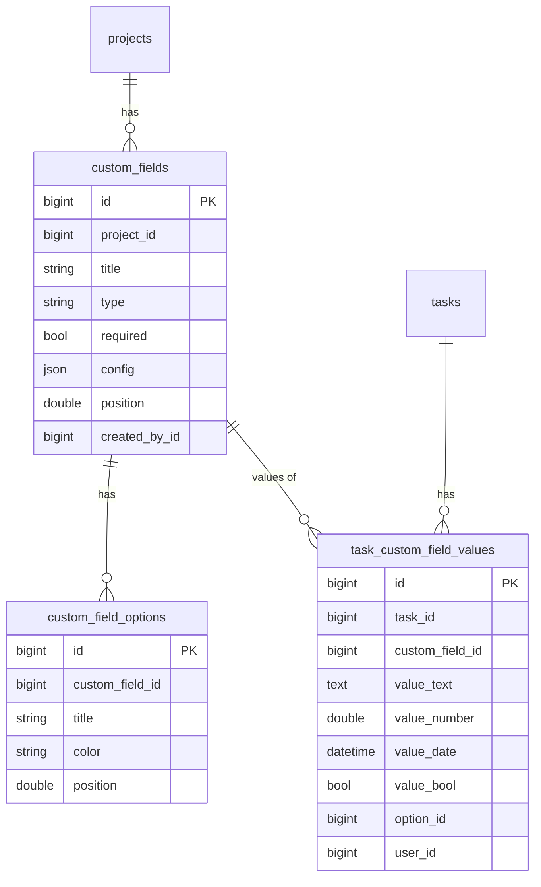

# Custom fields

Per-project fields on tasks, in thirteen types, that can be filtered, sorted, displayed, required on workflow transitions, used by automation and asked for in forms.

Design document and history: [docs/enterprise/custom-fields.md](../enterprise/custom-fields.md). API conventions: [API.md](../../API.md). Module index: [README.md](README.md).

## Overview

Upstream tasks have a fixed set of properties. Teams that track budgets, severities, customers or ratings end up encoding them in titles or labels. Custom fields let a project admin define typed fields for the tasks of one project, and let everyone with write access to a task fill them in. Because values are stored in typed columns, they can be filtered and sorted in SQL, like built-in fields, in task lists, views, saved filters, reports and automation conditions.

Audience: project admins define fields; project members fill and read them; operators need to know the limits (below).

## Concepts

- **Field definition.** Belongs to a project: title, description, type, a `required` flag, a type-specific `config`, a position, and (for select types) options. The `required` flag is used by workflow transitions (a transition can require a field), not enforced on every save.
- **Field value.** Belongs to a task and a field. Single-value types have at most one row per (task, field); `multi_select` and `user` have one row per selected option or user.
- **Types.** `text`, `long_text`, `number`, `currency`, `date`, `checkbox`, `select`, `multi_select`, `user`, `url`, `email`, `rating`, `progress`. The type cannot be changed after creation (error `20003`).
- **Config keys** by type: `min`, `max` (number, currency), `precision` (0 to 10, number and currency), `currency` (ISO 4217 code of at most three characters, currency), `max_rating` (1 to 10, default 5, rating).
- **Validation on write.** Number and currency respect `min` and `max`; rating is an integer from 1 to `max_rating`; progress is 0 to 100; url and email are format-checked; select and multi select option ids must belong to the field; user ids must have read access to the task's project. Failures are `20005` (invalid value), `20008` (a text value longer than 65535 bytes; also an invalid value for callers that check for one, such as forms) or `20004` (unknown option).
- **JSON shape of a value** depends on the type: string (`text`, `long_text`, `url`, `email`), number (`number`, `currency`, `rating`, `progress`), RFC 3339 string (`date`), boolean (`checkbox`), option id (`select`), array of option ids (`multi_select`), array of user ids (`user`). Sending `null`, or an empty array for `multi_select` and `user`, clears the value.
- **Field references** in other documents (filters, workflow required fields, automation conditions and actions, form targets, report dimensions) are written `cf_<id>`.

## Data model

Tables are created by `pkg/migration/20261122120000.go`. `custom_fields.project_id`, `custom_field_options.custom_field_id`, and `task_custom_field_values.task_id`, `custom_field_id`, `option_id`, `user_id` are indexed. Values are typed columns (not one JSON blob) so that filters and sorts run in SQL: text types use `value_text`, number, currency, rating and progress use `value_number`, date uses `value_date`, checkbox uses `value_bool`, select and multi select use `option_id`, user uses `user_id`.

Lifecycle: deleting a field deletes its options and values; deleting a task or purging a project deletes the values and definitions that belong to it (values are removed when a task is purged, not when it is moved to the trash); duplicating a project copies definitions and the values of the copied tasks with remapped ids; duplicating a task inside the same project copies its values; moving a task to another project (single or bulk) deletes its values for fields of the old project and keeps values of fields that exist in the new one.

## Permissions

| Action | Needs |
|---|---|
| Read definitions | read on the project |
| Create, update, delete a definition | admin on the project |
| Read values of a task | read on the task |
| Set or clear a value | write on the task, and a field that belongs to the task's project |

Link shares follow the share's permission for values and can never change definitions. An unknown field id, a field of a project the caller cannot read and a malformed identifier in a filter all answer the same `400` (`4016`), so field ids of other projects cannot be probed. Permission methods are in `pkg/models/custom_fields_permissions.go`.

## API

All routes are on `/api/v2`. Conventions (envelopes, ETags, errors) are in [API.md](../../API.md). A `PATCH` is also available for a field definition.

| Method | Path | Operation ID | Permission | Description |
|---|---|---|---|---|
| GET | `/projects/{project}/custom-fields` | `custom-fields-list` | read on project | List the custom fields of a project |
| GET | `/projects/{project}/custom-fields/{field}` | `custom-fields-read` | read on project | Get a custom field |
| POST | `/projects/{project}/custom-fields` | `custom-fields-create` | admin on project | Create a custom field |
| PUT | `/projects/{project}/custom-fields/{field}` | `custom-fields-update` | admin on project | Update a custom field |
| DELETE | `/projects/{project}/custom-fields/{field}` | `custom-fields-delete` | admin on project | Delete a custom field |
| GET | `/tasks/{task}/custom-field-values` | `task-custom-field-values-list` | read on task | List the custom field values of a task |
| PUT | `/tasks/{task}/custom-field-values/{field}` | `task-custom-field-values-set` | write on task | Set a custom field value on a task |
| DELETE | `/tasks/{task}/custom-field-values/{field}` | `task-custom-field-values-clear` | write on task | Clear a custom field value on a task |

An update of a definition replaces the submitted options: options with an id are updated, options without one are created, and options left out are deleted together with every value that references them. Task list and single task reads accept `expand=custom_fields`, which embeds `custom_fields: [{"custom_field_id", "type", "value"}]` (fields without a value are left out; a checkbox set to `false` counts as a value; the values of a page are loaded in two queries). API tokens need `tasks_custom_field_values` `read_all` for the expand.

**Filtering and sorting.** `cf_<id>` works in the `filter` and `sort_by` parameters wherever the filter syntax does. The comparators by type are listed in [API.md](../../API.md#filter-syntax). Sorting works for all single-value types, select fields sort by option position, tasks without a value sort last in both directions, and `multi_select` and `user` cannot be sorted by (`400`).

## Configuration keys

| Key | Default | Meaning |
|---|---|---|
| `customfields.maxfieldsperproject` | `100` | The most custom fields one project can have. Creating a field over the limit is refused (`409`, code `20006`). A project that already has more fields (the limit was lowered) keeps them, and they can be edited and deleted; duplicating a project copies its fields whatever the limit. Concurrent creates can overshoot by about the number of requests in flight. A value of 0 or less is read as the default. |
| `customfields.maxoptionsperfield` | `200` | The most options one select or multi select field can have. Creating or saving a field with more options than the limit **and** than it already has is refused (`400`, code `20007`); a field that already has more options keeps them and can be edited and shrunk, not grown. A value of 0 or less is read as the default. |

Field values share the file and database settings of the instance.

## UI

- **Definitions**: project settings, Custom fields (`project.settings.custom-fields`), project admins only. Title, type (fixed after creation), required, per-type config and an option list with colours.
- **Task detail**: one editor per type under the other task properties. Values save per field.
- **Display**: a read-only component renders values in table cells and kanban cards. The Columns menu of a table view lists the custom fields (off by default); a kanban view has a "Card fields" menu. Both choices are stored in the browser (`localStorage` keys `tableViewCustomColumns` and `kanbanCardFields`), not on the server; the view requests `expand=custom_fields` only while a field is shown.
- **Filter input**: shows and accepts field names and option titles (`Budget > 100`), sends `cf_<id>` and option ids; saved filters keep the id form, so renaming a field breaks nothing. Names with spaces are double quoted, built-in names win unless quoted, colliding names get the project title appended.

More in [DESIGN.md](../../DESIGN.md#custom-fields).

## Events and interaction with other modules

- **Events**: `custom-field.created`, `custom-field.updated`, `custom-field.deleted`, and `task.custom-field-value.updated` (task, field, old and new value, doer).
- **Workflows**: a transition can list `cf_<id>` fields as required before it is allowed ([workflows](workflows.md)).
- **Automation**: the `task.custom_field_changed` trigger listens to `task.custom-field-value.updated`; conditions can compare `cf_<id>`; the `task.set_custom_field` action and `vikunja.fields.get` / `vikunja.fields.set` in scripts write values through the same validation. Deleting a field disables rules that reference it with the reason `custom_field_deleted` ([automation](automation.md)).
- **Forms**: a form field can target `cf_<id>`; deleting a used field disables the form ([forms](forms.md)).
- **Reports**: select, multi select, user, checkbox and rating fields are dimensions; number, currency, rating and progress fields are measurable ([dashboards and reports](dashboards-reports.md)).
- **Approvals**: a `user` field can be an approver source ([approvals](approvals.md)).

## Limits and safety

- A definition title is at most 250 characters; option titles 250; `precision` 0 to 10; `max_rating` 1 to 10.
- At most `customfields.maxfieldsperproject` fields per project (default 100) and `customfields.maxoptionsperfield` options per field (default 200); only adding is refused, see [Configuration keys](#configuration-keys).
- A text, long text, url or email value is at most **65535 bytes** (not characters: a euro sign is three bytes, an emoji four), the size of the `value_text` column on MySQL, so a value that is stored on one database is stored on all three (`20008`). A text value with a NUL character is refused with `20005` on every database, because PostgreSQL cannot store it. The check runs for every writer of values: the API, forms, automation and scripts. Field descriptions (`text` column as well) are not length-checked.
- Date `=` compares the exact stored instant; use a range for a day.

## Known gaps and open decisions

From the [roadmap](../enterprise/ROADMAP.md):

- Not exposed over MCP.
- `vikunja.tasks.find` in scripts with `cf_` filters was not tested.
- UI: hover and focus styling and the read-only state for users without write access were not exercised in a browser; long text shows a single clipped line until focused.
- Which databases the custom field tests have been run on is recorded in the roadmap.

## Where the code lives

| What | Where |
|---|---|
| Models, validation, values | `pkg/models/custom_fields.go`, `pkg/models/custom_field_values.go` |
| Permissions | `pkg/models/custom_fields_permissions.go` |
| Filter and sort | `pkg/models/custom_field_filter.go` |
| Expand | `pkg/models/custom_field_expand.go` |
| Events | `pkg/models/custom_field_events.go` |
| Errors | `pkg/models/error_custom_fields.go` (`20001` to `20008`) |
| Routes | `pkg/routes/api/v2/custom_fields.go` |
| Migration | `pkg/migration/20261122120000.go` |
| Limits | `pkg/models/custom_field_limits.go` |
| Tests | `pkg/models/custom_field_limits_test.go`, `pkg/models/custom_fields_test.go`, `pkg/models/custom_field_filter_test.go`, `pkg/models/custom_field_expand_test.go`, `pkg/webtests/huma_custom_field_test.go`, `pkg/webtests/huma_custom_field_filter_test.go` |
| Frontend | `frontend/src/components/custom-fields/`, `frontend/src/views/project/settings/ProjectSettingsCustomFields.vue`, `frontend/src/client/queries/customFields.ts`, `frontend/src/helpers/customFields.ts`, `customFieldDisplay.ts`, `customFieldFilter.ts` |
