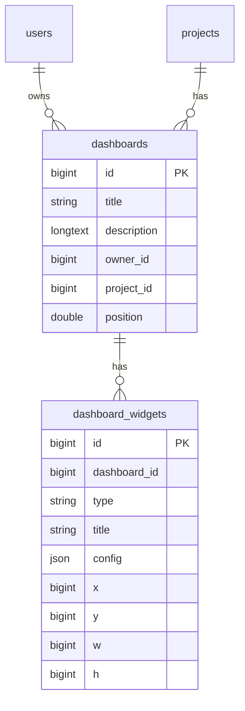

# Dashboards and reports

A task aggregation API (reports) and dashboards of widgets over task filters. Every number is computed at request time over the tasks the viewer is allowed to read.

Design document and history: [docs/enterprise/dashboards.md](../enterprise/dashboards.md). API conventions: [API.md](../../API.md). Module index: [README.md](README.md).

## Overview

A manager wants one page that shows where work stands: how much is open, what is late, who is loaded, how fast things get done. The module provides the counting (reports) and the page (dashboards). Everything on a dashboard is a **widget over a task filter**, so it uses the vocabulary people already know from views: the same filter syntax, including `status`, `status_category` and `cf_<id>`.

Audience: project admins build project dashboards; everyone can build personal dashboards; operators tune the bounds that protect the database.

There are no snapshot tables: aggregates are plain SQL over existing tables, computed per request, with a short in-memory cache.

## Concepts

- **Report.** A request that counts tasks, or sums, averages or finds the smallest or largest value of a numeric field, optionally grouped by up to two dimensions and optionally as a time series. `POST /reports/tasks` is the core; `status-time`, `workload` and `time-tracking` are specialised reports; every report has a CSV export.
- **Scope.** `project_id` selects one project; absent or `0` means all projects the viewer can read; `-1` means favorites. Saved filters (project ids below `-1`) are not a report scope.
- **Dimensions** (`group_by`, `then_by`): `status`, `status_category` (only meaningful where a workflow exists), `assignee`, `label`, `project`, `priority`, `done`, `created_by`, and `cf_<id>` of a select, multi select, user, checkbox or rating field. Any other field kind is `400` / `23004`.
- **Measures**: `count` (default), `sum`, `avg`, `min`, `max`. `field` for the numeric measures: `percent_done`, `time_spent`, or `cf_<id>` of a number, currency, rating or progress field.
- **Time series**: `time: {field, bucket, from, to, timezone}` with `field` one of `created`, `done_at`, `due_date`, `status_entered`; `bucket` `day` (default), `week` (starts Monday) or `month`; `from` and `to` as RFC 3339, `YYYY-MM-DD`, `now` or date math (default `now-90d` to `now`); `timezone` an IANA name (default: the user's time zone setting, else the instance's). `compare: previous_period` computes the same measure for the period right before, shifted by as many buckets; when `to` lies inside its last bucket both periods are counted for the same elapsed time.
- **Groups.** A task with several values (assignee, label, multi select, user field) counts in each group; `multi_valued` says so and `total` stays the number of distinct tasks. Tasks without a value form the `none` group; the folded rest is one `other` group. `priority` 0 counts as no value; `done` and checkbox fields have no none group.
- **Names the server writes itself.** The names of a group that belong to the data (a project, a label, a user, a status) are as stored. The ones the server writes (the four status categories, `done` / not done, checked / not checked, the five priorities) are English in `label`, and `label_code` (`status_category.open`, `done.true`, `checked.false`, `priority.3`, ...) names them so a client can say them in the language of the reader; the interface does, and a code it does not know shows `label`. The CSV files the server writes (headers, `Yes` / `No`) are English whatever the language of the reader.
- **Widgets.** `number`, `bar`, `donut`, `line`, `created_vs_done`, `task_list`, `workload`, `status_time`, `time_tracking`, `text`. Config is decoded strictly per type (unknown keys are an error, path `23008`). A report inside a config is validated like `POST /reports/tasks` validates it but is not run on save.
- **Dashboards.** Personal (`project_id` 0: owned by one user, spans all projects the viewer can read) or project (visible to everyone who can read the project). Widgets are part of the dashboard document, on a 12-column grid.

### Report semantics worth knowing

- **Permissions.** The set of tasks is built by the code of the task list (`TaskCollection.readableTasksQuery`, with the filter conversion shared with search), for the requesting auth: project access, shares, teams, favorites, link shares pinned to their project. There is no separate permission logic. Group labels are looked up only for keys that occur on those tasks.
- **`time_spent`** is the sum of finished time entries (`end_time` set) per task in seconds; running timers are ignored. It is not available to link shares (`403` / `23005`).
- **Time series** have empty buckets inside the range with `0`; the first bucket contains `from`, the last contains `to`, the range is half open; tasks whose date is empty are counted in `excluded`.
- **Time in status** uses only history of the statuses of the project's current workflow (archived ones included): a visit lasts until the next history entry; the last one is open only when it is the task's current status; a task without counted history is counted from when it entered its current status; a plain date `to` includes that day.
- **Workload** counts open tasks per assignee split by due date (overdue, this week until Monday, next week, later, none), and optionally adds up a numeric custom field as an estimate; unassigned tasks form their own row.
- **Time tracking** adds up finished time entries in a date range by user, project, label or day, for the entries the time entry list shows the caller; it needs the time tracking feature and is not available to link shares.
- **Time buckets are computed in Go** in the requested time zone, so daylight saving is exact; the database receives boundaries as a balanced tree of `CASE WHEN column < 'boundary'` expressions (see [ARCHITECTURE.md](../../ARCHITECTURE.md#reports)). The week start is not configurable.
- **Statements per request**: without `group_by`, one for the totals plus one for a time series (plus one to count `excluded`); each dimension level is one grouped statement. The count never depends on the number of groups or tasks.

## Data model

Created by `pkg/migration/20261122160000.go`. `dashboards.project_id` is `0` for a personal dashboard (the column is `not null default 0`, so the relation to projects applies to project dashboards only). Reports have no tables of their own. Defaults for a new widget are `w` 4 and `h` 3. Limits in code: at most 50 widgets per dashboard, 12 grid columns, a widget's `y` between 0 and 1000, a `text` widget at most 20000 characters, a `task_list` at most 100 rows and 30 columns.

Lifecycle: purging a project deletes its dashboards; deleting a user deletes their personal dashboards (project dashboards they created stay); duplicating a project copies its dashboards (owner = the duplicating user) and remaps `cf_<id>`, option ids, `status` ids and `project_id` in filters and fields (`dashboards_lifecycle.go`).

## Widget types and configs

| Type | Shows | Config (decoded strictly) |
|---|---|---|
| `number` | One figure, optionally with the previous period | `{request, compare}`; the request cannot group |
| `bar` | Groups, stacked with `then_by` | `{request}`; needs `group_by` |
| `donut` | Groups | `{request}`; one level |
| `line` | A time series, one line per group | `{request}`; needs `time` |
| `created_vs_done` | Two series: created and completed per bucket | `{project_id, filter, bucket, from, to}` |
| `task_list` | The tasks themselves | `{project_id, filter, sort_by, order_by, columns, limit}` (limit at most 100) |
| `workload` | Open tasks per assignee | `{project_id, filter, estimate_field}` |
| `status_time` | Time spent in each status | `{project_id, filter, group_by (assignee or label), from, to}` |
| `time_tracking` | Tracked time | `{project_id, from, to, group_by (user, project, label or day)}` |
| `text` | A note | `{text}` |

On a project dashboard every `project_id` is pinned to the project; another one is an error. Problems are `23008` with the path (`widgets[1].config.request.group_by`).

## Permissions

| Action | Needs |
|---|---|
| Run any report | a signed-in user; the tasks are limited to what the user can read (and the project, if one is given) |
| `time_spent` and the time tracking report | not available to link shares (`403` / `23005`) |
| List dashboards | own personal dashboards plus those of every readable project |
| Read a dashboard | its owner (personal) or read on the project (project; link shares of that project included) |
| Create | any user (personal) or admin on the project (project) |
| Update, delete, change the layout | the owner (personal) or admin on the project (project); link shares never change dashboards |

`max_permission` is 2 for those who may change a dashboard. Permission methods are in `pkg/models/dashboards_permissions.go`.

## API

All routes are on `/api/v2`; conventions are in [API.md](../../API.md). A `PATCH` is also available for a dashboard.

| Method | Path | Operation ID | Permission | Description |
|---|---|---|---|---|
| GET | `/dashboards` | `dashboards-list` | signed-in user (own personal and readable project dashboards) | List dashboards |
| GET | `/dashboards/{dashboard}` | `dashboards-read` | owner (personal) or read on project | Get a dashboard |
| POST | `/dashboards` | `dashboards-create` | any user (personal) or admin on project | Create a dashboard |
| PUT | `/dashboards/{dashboard}` | `dashboards-update` | owner (personal) or admin on project | Update a dashboard |
| DELETE | `/dashboards/{dashboard}` | `dashboards-delete` | owner (personal) or admin on project | Delete a dashboard |
| PUT | `/dashboards/{dashboard}/layout` | `dashboards-layout` | owner (personal) or admin on project | Move and resize widgets |
| POST | `/reports/tasks` | `reports-tasks` | signed-in user, tasks limited to what the user can read | Aggregate tasks |
| POST | `/reports/tasks/export` | `reports-tasks-export` | as reports-tasks | Export an aggregate report as CSV |
| POST | `/reports/tasks/export/rows` | `reports-tasks-export-rows` | as reports-tasks | Export the tasks behind a report as CSV |
| POST | `/reports/status-time` | `reports-status-time` | as reports-tasks | Time tasks spent in each status |
| POST | `/reports/status-time/export` | `reports-status-time-export` | as reports-tasks | Export the time in status report as CSV |
| POST | `/reports/workload` | `reports-workload` | as reports-tasks | Open tasks per assignee |
| POST | `/reports/workload/export` | `reports-workload-export` | as reports-tasks | Export the workload report as CSV |
| POST | `/reports/time-tracking` | `reports-time-tracking` | signed-in user, not for link shares | Tracked time per user, project, label or day |
| POST | `/reports/time-tracking/export` | `reports-time-tracking-export` | as reports-time-tracking | Export the time tracking report as CSV |
| GET | `/reports/tasks/options` | `reports-tasks-options` | signed-in user (read on project for project_id) | List what a task report can use |

`GET /reports/tasks/options?project_id=` lists what a request may use in a scope (dimensions including the `cf_<id>` fields of that project, measures with their numeric fields, time fields, whether a workflow exists, the limits of this instance); the widget editor is generated from it. The dashboard document carries its widgets: a read includes them, and a `PUT` with `widgets: [...]` replaces them as a whole (an id of this dashboard keeps and updates the widget, no id creates, missing ones are deleted; `null` or no `widgets` keeps them; an id of another dashboard is `404` / `23007`). `PUT .../layout` with `{"items": [{"id", "x", "y", "w", "h"}]}` only moves and resizes (`x + w <= 12`).

A worked report request and response are in [API.md](../../API.md#examples). Request problems are `400` / `23001` with `details.param`; enum and range violations of the schema are `422`. Error codes `23001` to `23011` are in [API.md](../../API.md#errors).

**CSV export.** `POST /reports/tasks/export`, `/reports/status-time/export`, `/reports/workload/export` and `/reports/time-tracking/export` return the same report as a CSV file; `POST /reports/tasks/export/rows` returns the tasks behind a report (what a drill-down lists) with the core columns and one column per custom field. Files are UTF-8 with a byte order mark so Excel reads them correctly, comma separated; cells that start with `=`, `+`, `-` or `@` are prefixed with a single quote so a spreadsheet does not run them.

## Configuration keys

| Key | Default | Meaning |
|---|---|---|
| `reports.cachettl` | `30s` | How long the result of a report is cached in memory, per user and request. Set to 0 to disable the cache. |
| `reports.maxgroups` | `200` | The maximum number of groups a report returns per level. Requests asking for more are rejected; groups beyond a request's limit are folded into one "other" group. |
| `reports.maxbuckets` | `366` | The maximum number of time buckets (days, weeks or months) of a time series report. |
| `reports.maxrows` | `50000` | The maximum number of rows a report that is computed in memory (time in status, time tracking) or a CSV export of tasks reads. Requests that would read more are rejected. |
| `reports.maxcells` | `50000` | The maximum number of values one task report returns: groups, child groups and the time points of every leaf group. Reports above it are refused (`23011`) after the groups are known and before the time series are read. `0` disables the limit. |
| `reports.timeout` | `20s` | The maximum duration of the database queries of one report. The queries are cancelled when it is exceeded. |

## UI

- **Pages**: `/dashboards` (personal and project dashboards, create, rename, delete), `/dashboards/:id` (view and edit), `/projects/:id/dashboards` and a "Dashboards" sidebar link. A new dashboard starts with open tasks, tasks by status (or by done without a workflow), created vs completed over 30 days, open tasks by assignee and an overdue task list.
- **Charts** are hand-written SVG (bar, stacked and grouped bar, donut, line, number tile) with tooltips, hidden data tables, empty, loading and error states.
- **Grid**: 12 columns, one column at 768 px and below; edit mode with drag, resize, keyboard control, compaction, a visible save state and undo.
- **Widget editor**: type gallery, a form built from the report options, the view filter editor, relative period presets and a live preview of the unsaved configuration.
- **Drill-down** lists exactly the tasks behind a mark; marks that cannot be expressed in the filter syntax are inert and say why. A number, bar, donut or line widget with a time range lists (and exports) only the tasks of that range; created vs completed lists the tasks created in the range of the first series or done in the range of the second. **CSV export** from the widget menu and the drill-down; number widgets can compare with the previous period.
- Bar direction, stacking and legend are per-viewer browser settings.

Details: [DESIGN.md](../../DESIGN.md#dashboards-and-reports).

## Events and interaction with other modules

- Reports read tasks, statuses and status history ([workflows](workflows.md)), custom fields ([custom fields](custom-fields.md)), labels, assignees and time entries. Nothing is written by reports.
- Dashboards dispatch no events and are not an automation trigger. Scheduled e-mail of a dashboard is listed in the design document as a possible later automation action.
- The report scope code is shared with the task list, so any change to what the task list may show is a change to what reports may count.

## Limits and safety

- At most two dimensions plus time.
- `reports.maxbuckets` time buckets (`23002`), `reports.maxgroups` groups per level (`23003` for a request that asks for more; groups beyond a request's `limit`, default 20, fold into `other`).
- `reports.maxcells` result cells (`23011`) for a task report. The default `50000` is about 4 MB of JSON; the widgets the editor offers stay far below it (a line chart of 20 groups over 366 daily buckets is about 7,300 cells, a grouped bar chart of two dimensions over 30 days with 5 x 5 groups is under 1,000). The two-dimension case with 20 x 20 groups over 366 buckets (about 160,000 cells, 13 MB) is what it exists to refuse.
- `reports.maxrows` rows for reports computed in memory (time in status, time tracking) and CSV exports (`23010`). The rows read (history, current statuses, assignees or labels) are bounded by it.
- Names of groups (users, projects, labels, statuses, field options) are looked up in chunks of 500 ids, so a report over more distinct values than a database accepts parameters in one statement still runs. The task ids of the time tracking report are a subquery, never a list.
- `reports.timeout` for the database queries of one report; exceeded queries are cancelled (`503` / `23009`).
- A cache per authenticated identity and normalized request for `reports.cachettl`, at most 256 entries, no invalidation; `0` disables it. In a multi-instance deployment each process has its own cache.
- Bucket boundaries are second precision; there is one time zone per request.

## Known gaps and open decisions

From the [roadmap](../enterprise/ROADMAP.md):

- Default dashboards for new projects with a workflow are not created.
- `created_vs_done` has no server-side running open count (the client combines two reports); a `text` widget stores the editor's HTML, sanitized on render; the `line` chart does not offer a second dimension.
- The new widgets (time in status, workload, time tracking), CSV export and the previous-period comparison were checked in a browser (see the roadmap); the workload estimate field was not.
- Not exposed over MCP.
- Which databases the reports tests have been run on is recorded in the roadmap.

## Where the code lives

| What | Where |
|---|---|
| Report request, dimensions, measures | `pkg/models/reports.go`, `pkg/models/reports_dimensions.go`, `pkg/models/reports_options.go` |
| Time buckets and time zones | `pkg/models/reports_time.go` |
| Specialised reports | `pkg/models/reports_status_time.go`, `pkg/models/reports_workload.go`, `pkg/models/reports_time_tracking.go` |
| Cache | `pkg/models/reports_cache.go` |
| CSV export | `pkg/models/reports_export.go`, `pkg/models/csv_export.go` |
| Dashboards and widgets | `pkg/models/dashboards.go`, `pkg/models/dashboards_widgets.go`, `pkg/models/dashboards_lifecycle.go`, `pkg/models/dashboards_permissions.go` |
| Errors | `pkg/models/error_reports.go` (`23001` to `23011`) |
| Routes | `pkg/routes/api/v2/reports.go`, `pkg/routes/api/v2/dashboards.go` |
| Task list scope | `pkg/models/task_collection.go` (`readableTasksQuery`) |
| Migration | `pkg/migration/20261122160000.go` |
| Tests | `pkg/models/reports_test.go`, `pkg/models/reports_extra_test.go`, `pkg/models/dashboards_test.go`, `pkg/webtests/huma_reports_test.go`, `pkg/webtests/huma_reports_export_test.go` |
| Frontend | `frontend/src/components/dashboards/`, `frontend/src/components/charts/`, `frontend/src/views/dashboards/`, `frontend/src/client/queries/dashboards.ts`, `reports.ts`, `reportWidgets.ts`, `frontend/src/helpers/dashboard*.ts` |
