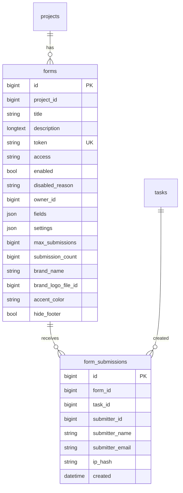

# Forms

Forms whose submissions become tasks: for project members, for signed-in users, or for anyone with a link.

Design document and history: the "Forms" part of [docs/enterprise/forms-approvals.md](../enterprise/forms-approvals.md). API conventions: [API.md](../../API.md). Module index: [README.md](README.md).

## Overview

A team wants to publish a request form ("New cover request", "Purchase request", "Bug report") and get a task, with the answers in the task's fields, without giving the requester an account or access to the project. A form is a view of the project's own fields: the builder picks which task fields and custom fields to ask for. There is no second field system. Because the task is created through the normal create path, the workflow's initial status, custom field validation and automation all apply.

Audience: project admins build forms; requesters fill them; operators decide whether public forms and public attachments are allowed and tune the limits.

## Concepts

- **Form** (`forms`): a project, a title, a description (rich text shown above the form), an unguessable **token** (the public address is `/forms/<token>`), an **access** mode, `enabled`, an **owner**, an ordered `fields` list, `settings`, branding, and counters.
- **Access modes**: `members` (signed-in users who can read the project), `users` (any signed-in user), `public` (anyone with the link). Link shares are not users: `403` for `users` and `members`, treated as anonymous for `public`.
- **Fields** (at most 50): `{target, label, help, required, default, hidden, options}`. `target` is `title`, `description`, `due_date`, `priority`, `labels`, `attachments` or `cf_<id>`. `title` is mandatory: asked, or built from a template such as `Request from {{submitter.name}}`. `hidden` fields are not shown and always take their default, which is how a status, label or custom field is pre-set. `options` (only for a shown `labels` field) lists the label ids the submitter may pick; not allowed on public forms.
- **Settings**: `initial_status_id`, `default_assignee_ids`, `success_message`, `redirect_url`, `submit_another`, `close_date`, `max_submissions`, `notify_user_ids`, `collect_name`, `name_required`, `collect_email`, `email_required`.
- **Branding**: `brand_name` (at most 100 characters), `accent_color` (`#rrggbb`), `hide_footer`, and a logo (PNG, JPEG, GIF or WebP, no SVG, at most 1 MiB; decoded, scaled down to at most 512 pixels and stored as PNG; served without authentication whatever the access mode).
- **Owner**: the user who last saved the form. Submissions create tasks as the owner. If the owner loses write access to the project, or is deleted, the form is disabled with a reason.
- **Placeholders** in title and description defaults and text custom fields: `{{submitter.name}}`, `{{submitter.email}}`, `{{form.title}}`, `{{date}}`. Plain substitution; answers are never substituted.
- **Disabled reasons**: `owner_not_writer`, `owner_unavailable`, `custom_field_deleted`, `status_deleted`, `label_deleted`, `duplicated`, `duplicated_unmapped_reference`. Saving the form clears the reason; send `enabled: true` to turn it on again.

### Behaviour of a submission

One transaction: lock the form row; check availability and access; the honeypot; the rate limits; load the owner and check that they can still write to the project (otherwise the form is disabled, that change is committed, nothing else is created, and the answer is `410` `disabled`); validate every visible field; count the submission; create the task with `Task.Create` as the owner (workflow initial status, `task.created` and the automation outbox apply); write custom field values, labels, default assignees, the initial status override (a system transition without checks) and the attachments; record the submission; and dispatch `form.submitted` on commit.

- Hidden targets cannot be supplied by the client. A shown field missing from `values` takes its default.
- Values are validated with the field's own rules; errors are `422` / `25006` with one entry per field: `required`, `invalid`, `too_long`, `too_many`, `unknown_field` (also for hidden targets), `file_too_large`, `file_type_not_allowed`, `attachments_disabled`; submitter details are `submitter.name` and `submitter.email`.
- Rich text is HTML sanitized by an allow-list (basic formatting, links with http, https and mailto, no images, styles or handlers); text that is not HTML is escaped into paragraphs. Titles and custom field text are stored as plain text without control characters. A "Submitted by name <email>" paragraph is added to the description when a name or an e-mail address is known. `submitter.name` and `submitter.email` are only taken when the form collects them; otherwise they are ignored and a signed-in submitter is recorded with the account name. On forms for `members` and `users` the e-mail address of the account is also stored on the submission (`submitter_email`, when the form did not collect an address; an address the form collected wins). It is read from the account, not from the token, and it is kept out of the task description, the placeholders and the `form.submitted` event, whose audience (everybody who can read the task, automation rules, webhooks) is wider than the project admins who can list the submissions. Public forms never take it, signed in or not.
- Value caps (fixed): title 250 characters, text, url and email 10000, long text 50000.
- Attachments travel in **one multipart request** (`POST /forms/{token}/submissions/multipart`): the part `data` holds the JSON and the parts `files` the files, in one transaction, so a rejected file creates nothing. The JSON endpoint cannot carry files; a form that asks for attachments requires the multipart one. Files are sniffed by content (not only by extension); executable, script, HTML and SVG types are rejected.
- The response contains `message`, `redirect_url` and `submit_another`. `task_id` is added only for signed-in submitters who can read the project, never for public submissions. A honeypot hit (a non-empty `honeypot`) is answered like a success and creates nothing.

## Data model

Created by `pkg/migration/20261125100000.go`; the branding columns are added by `pkg/migration/20261126100000.go` with `partialSync`. `forms.max_submissions` is a copy of `settings.max_submissions` so the maximum can be enforced with one conditional `UPDATE`. `form_submissions.created` is set by the code, not by xorm, so the rate limits can be tested with a clock. `ip_hash` is stored only as `HMAC-SHA256(key derived from service.secret, ip)` and is indexed for rate limiting; it is never returned.

Lifecycle: purging a project deletes its forms and submissions; deleting a form keeps the tasks it created; duplicating a project copies forms **disabled** with a new token and remapped custom field, option and status ids; deleting a custom field, a workflow status or a label that a form uses disables the form; deleting the owner disables their forms.

## Permissions

| Action | Needs |
|---|---|
| Builder: list, read, create, update, delete, regenerate the token, upload or remove the logo, list submissions, read the options | admin on the project; never for link shares |
| Public read of the definition and the logo | the token; the access mode is checked for `users` and `members` forms |
| Submit | per access mode: nothing for `public`, any signed-in user for `users`, a signed-in user who can read the project for `members` |

The public routes are optional-auth: with no `Authorization` header the caller is anonymous; with one it is validated like anywhere (an invalid or expired token is `401` code `11`). An anonymous request to a non-public form is `401` / `25004`. A signed-in user who cannot read the project of a `members` form, or a link share, gets `403` / `25005`. The logo is served to everyone who knows the token, whatever the access mode, because a browser cannot send credentials with an image request. Permission methods are in `pkg/models/forms_permissions.go`.

## API

All routes are on `/api/v2`; conventions are in [API.md](../../API.md). A `PATCH` is also available for a form.

| Method | Path | Operation ID | Permission | Description |
|---|---|---|---|---|
| GET | `/projects/{project}/forms/options` | `forms-options` | admin on project | List what a form of the project can ask for |
| GET | `/projects/{project}/forms` | `forms-list` | admin on project | List the forms of a project |
| GET | `/projects/{project}/forms/{form}` | `forms-read` | admin on project | Get a form |
| POST | `/projects/{project}/forms` | `forms-create` | admin on project | Create a form |
| PUT | `/projects/{project}/forms/{form}` | `forms-update` | admin on project | Update a form |
| DELETE | `/projects/{project}/forms/{form}` | `forms-delete` | admin on project | Delete a form |
| POST | `/projects/{project}/forms/{form}/token` | `forms-token` | admin on project | Regenerate the token of a form |
| PUT | `/projects/{project}/forms/{form}/logo` | `forms-logo-upload` | admin on project | Upload the logo of a form |
| DELETE | `/projects/{project}/forms/{form}/logo` | `forms-logo-delete` | admin on project | Remove the logo of a form |
| GET | `/projects/{project}/forms/{form}/submissions` | `form-submissions-list` | admin on project | List the submissions of a form |
| GET | `/forms/{token}` | `form-public-read` | none for public forms, else per access mode | Get the public definition of a form |
| GET | `/forms/{token}/logo` | `form-public-logo` | none, the token is the credential | Get the logo of a form |
| POST | `/forms/{token}/submissions` | `form-public-submit` | none for public forms, else per access mode | Submit a form |
| POST | `/forms/{token}/submissions/multipart` | `form-public-submit-multipart` | none for public forms, else per access mode | Submit a form with files |

The public definition (`GET /forms/{token}`) exposes only what a submitter needs: title, description, the shown fields in order with label, help, requiredness, `kind`, `config`, options, a `max_length` where it applies and the prefill `default` (omitted when it contains a placeholder), the success behaviour, which details of the submitter are asked, the branding (`branding: {name, accent_color, has_logo, hide_footer}`) and, when attachments are asked, `attachments: {max_files, max_file_size}`. It names no project, owner, count, hidden field or default, and no user or label list (labels only on non-public forms). Definition errors on save are `400` / `25002` with `details.issues[] = {path, message}` (for example `fields[2].target`). Worked requests and responses are in [API.md](../../API.md#examples).

Error codes: `25001` unknown token or form (404), `25002` invalid definition (400), `25003` form takes no submissions (410; `details.reason` is `disabled`, `closed` or `full`), `25004` login required (401), `25005` not allowed (403), `25006` invalid answers (422), `25007` rate limited (429 with `Retry-After`), `25008` forms disabled on the instance (403, on saving), `25009` invalid logo (400).

## Configuration keys

| Key | Default | Meaning |
|---|---|---|
| `forms.enabled` | `true` | Kill switch for the whole instance. When false no form takes submissions: the public endpoints answer 410 (disabled) for every existing form. |
| `forms.maxbodysize` | `262144` | The maximum size of the JSON body of a submission, in bytes. Larger requests are rejected with 413. |
| `forms.maxattachments` | `5` | The maximum number of files a single submission may attach. |
| `forms.maxattachmentsize` | `10MB` | The maximum size of one attached file. The smaller of this and files.maxsize applies. |
| `forms.public.enabled` | `true` | Whether forms with public access exist. When false, a form with public access cannot be saved and existing ones answer 410 (disabled). |
| `forms.public.attachments` | `false` | Whether public forms may ask for file attachments. Off by default: an anonymous upload is the riskiest thing a public form can offer. |
| `forms.public.ratelimit` | `10` | The maximum number of submissions per client IP address and hour on public forms. Counted in the database from the stored salted IP hash, so it holds across several replicas. |
| `forms.public.formratelimit` | `300` | The maximum number of submissions per public form and hour, whoever sends them. Excess submissions are answered with 429 and a Retry-After header. |
| `forms.public.requestratelimit` | `60` | The maximum number of requests per client IP address and minute to the public form endpoints (definition and submissions together), counted by the same limiter store as ratelimit.store. A floor against floods; normal use never reaches it. |
| `service.ipextractionmethod` | `direct` | Method for extracting client IP addresses. 'direct' (default) uses the TCP remote address and ignores forwarding headers — use this when Vikunja faces the internet directly. |
| `service.trustedproxies` | `empty` | Comma-separated list of CIDR ranges for trusted reverse proxies. Only used when service.ipextractionmethod is 'xff' or 'realip'. |
| `files.maxsize` | `20MB` | The maximum size of a file, as a human-readable string. Warning: The max size is limited 2^64-1 bytes due to the underlying datatype |

## UI

Project settings, Forms (project admins): a list with link copy, an open and closed switch, submission counts, warning badges, duplicate and delete; a builder with Fields, Settings and Share tabs and a live preview; a submissions table. The public form is a standalone page at `/forms/<token>`, without app chrome or login, with branding, per-field errors and a confirmation screen. Details: [DESIGN.md](../../DESIGN.md#forms).

## Events and interaction with other modules

- **Event** `form.submitted` (form id and title, submission id, task, doer = form owner, submitter id, name and the e-mail address the form collected, never the one of the account; no token, no IP). Users in `settings.notify_user_ids` get the in-app (and mail) notification `form.submitted`, if they can read the project.
- **Automation**: `form.submitted` is a trigger (option `form_id`) with the condition fields `event.new.form_id`, `form_title`, `submitter_name`, `submitter_email` and the placeholders `{{event.form.title}}`, `{{event.form.submitter_name}}`, `{{event.form.submitter_email}}`. Its task is the created task; `task.created` of the same submission is delivered too ([automation](automation.md)).
- **Custom fields**: a form field can target `cf_<id>` and reuses the field's validation ([custom fields](custom-fields.md)). **Workflows**: new tasks get the initial status, or `initial_status_id` ([workflows](workflows.md)).

## Limits and safety

| Protection | Setting |
|---|---|
| Kill switch for all forms (public endpoints answer `410` `disabled`) | `forms.enabled` |
| Kill switch for public forms (cannot be saved, existing ones answer `410`) | `forms.public.enabled` |
| Submissions per client IP and hour on public forms, counted in the database from the salted hash, so it holds across replicas | `forms.public.ratelimit` |
| Submissions per public form and hour | `forms.public.formratelimit` |
| Request floor per IP and minute on the public routes (router middleware) | `forms.public.requestratelimit` |
| JSON body size, `413` above (also the `data` part of the multipart route) | `forms.maxbodysize` |
| Attachments on public forms | `forms.public.attachments` (off) |
| Files per submission, size per file (the smaller of it and `files.maxsize` applies) | `forms.maxattachments`, `forms.maxattachmentsize` |
| Honeypot | a non-empty `honeypot` is answered like a success and creates nothing |
| Maximum submissions | `settings.max_submissions`, enforced with `UPDATE forms SET submission_count = submission_count + 1 WHERE id = ? AND (max_submissions = 0 OR submission_count < max_submissions)` inside the submission transaction, after a lock write on the form row |
| Close date, disabled flag | `settings.close_date`, `enabled` |

Rate limits answer `429` with `Retry-After`; the hourly window runs on the clock of the server. The client IP is the one the router determines (`service.ipextractionmethod`, `service.trustedproxies`). The routes use no cookies and no CSRF token (nothing depends on ambient credentials); the CORS policy is the global one; JSON `Content-Type` is required, so a cross-site HTML form cannot post to the JSON endpoint.

**Security model.** An anonymous submitter can read the definition of one form and create one task per accepted submission, as the form owner, in the one project of the form, with the fields the form asks for and the presets the admin chose. They cannot choose where the task goes, set hidden fields, see the task or its id, see any other task, project, user or label, or learn how many submissions exist, and they cannot upload unless the instance and the form allow it, and then only limited, non-executable files. Every text they send is escaped, sanitized or stored as plain text. A form silently stops when its owner loses write access.

## Known gaps and open decisions

From the [roadmap](../enterprise/ROADMAP.md):

- The title of a closed `members` form is shown to an anonymous holder of the link; there is no hourly limit on `members` forms.
- Per-IP limits count full IPv6 addresses; hourly limits are check-then-insert; honeypot hits and validation failures only count against the per-minute request limit.
- Uploads are buffered before the token is looked up.
- The branding UI (brand name, accent colour, footer, logo) was checked in a browser (see the roadmap); the builder's live preview does not use the accent colour; a server-side `422` was only shown with a mocked response; relative date defaults are not offered; no QR code.
- Not exposed over MCP.
- Which databases the forms tests have been run on is recorded in the roadmap.

## Where the code lives

| What | Where |
|---|---|
| Form model, definition validation, options | `pkg/models/forms.go` |
| Submission path | `pkg/models/forms_submit.go` |
| Branding and logo | `pkg/models/forms_branding.go` |
| Lifecycle (duplicate, purge, disable) | `pkg/models/forms_lifecycle.go` |
| Permissions, events | `pkg/models/forms_permissions.go`, `pkg/models/form_events.go` |
| Errors | `pkg/models/error_forms.go` (`25001` to `25009`) |
| Routes | `pkg/routes/api/v2/forms.go`, `pkg/routes/api/v2/forms_public.go`; public path lists and floor in `pkg/routes/routes.go` |
| Migrations | `pkg/migration/20261125100000.go`, `pkg/migration/20261126100000.go` |
| Tests | `pkg/models/forms_test.go`, `pkg/models/forms_branding_test.go`, `pkg/automation/forms_test.go`, `pkg/webtests/huma_forms_test.go` |
| Frontend | `frontend/src/components/forms/`, `frontend/src/views/forms/PublicFormPage.vue`, `frontend/src/views/project/settings/ProjectSettingsForms.vue`, `frontend/src/client/queries/forms.ts`, `frontend/src/helpers/forms.ts`, `formsPublic.ts` |
