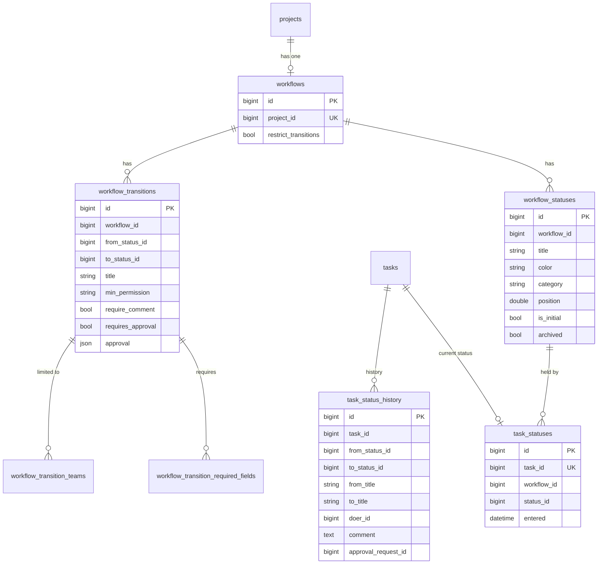

# Workflows

Real task statuses with rules for moving between them, independent of kanban buckets.

Design document and history: [docs/enterprise/workflow.md](../enterprise/workflow.md). Approvals, which plug into transitions, have their own page: [approvals](approvals.md). API conventions: [API.md](../../API.md). Module index: [README.md](README.md).

## Overview

Upstream Vikunja knows only `done` and not done, plus kanban buckets that belong to one view. A project that needs real states ("In review", "Waiting for client") and rules ("only an admin may close", "a due date is required before work starts") has no place to put them. A workflow gives a project statuses that are a property of the task, the same in every view, and rules for the transitions between them. A project without a workflow behaves exactly like upstream.

Audience: project admins define the workflow; members change statuses within the rules; operators need to know that enabling a workflow changes how "done" behaves in that project.

## Concepts

- **Workflow.** At most one per project. It holds statuses and transitions.
- **Status.** Title, colour, position and a **category**: `open`, `in_progress`, `done` or `cancelled`. Exactly one status is the initial one. The category decides the done flag: tasks in `done` and `cancelled` statuses are done. A status that still has tasks or history is archived instead of deleted (hidden from pickers, history stays readable), or the caller names a status to move its tasks to (`move_tasks_to`).
- **Transition.** A directed pair of statuses with optional rules: a button label, `min_permission` (`write` or `admin`), `require_comment`, required fields (built-in `assignees`, `due_date`, `start_date`, `end_date`, `description`, `attachments`, `labels`, or `cf_<id>`), allowed teams, and an approval requirement ([approvals](approvals.md)). `restrict_transitions` on the workflow decides whether only listed pairs are allowed (on) or whether every change is allowed and the transition rows only add rules (off).
- **Task status.** The current status of a task, kept in its own table, and the **status history** of every change (who, from, to, comment, the approval request if any).
- **Kanban status mode.** A kanban view can use the statuses as its columns.

### The status change

One function performs every status change. It checks, in order: the target status exists and is not archived (`21003`, `21004`); the transition is allowed (`21005`); the permission and teams (`21006`); the required fields and comment (`21007`, whose `details` name what is missing). Then, if the transition requires approval, it creates or returns a pending approval request instead of moving the task. Otherwise it writes history, syncs `done`, and dispatches `task.status.changed`.

### Done stays in sync

- Entering a `done` or `cancelled` status sets `task.done`; leaving it clears it.
- Marking a task done through the checkbox performs the transition to the first `done` status under the same checks; un-doing moves it back to the initial status.
- A task created already done starts in the first `done` status and counts as the transition from the initial status: its creator has to pass the checks, otherwise nothing is created. This also applies through CalDAV and to a done task moved in from another project.
- Removing a status with `move_tasks_to` moves its tasks as status changes the system makes: every task gets a history row and a `task.status.changed` event, and a `task.updated` event when the done flag changes with the category. The history entry has `cause: "status_removed"`, an empty `comment` and the title of the removed status in `from_title` (stored as a reserved marker at the start of the comment column, U+001E followed by `status_removed`, which the server strips from every comment a person sends; no column was added), the doer is the person who saved the workflow, and the editor writes the sentence in the language of the viewer. The event carries `cause` too. The events carry no automation origin, so the loop guards treat them like a person's change; rules that name the removed status are disabled before the move.
  - **Differences from the normal status change.** The rules of the transition, the approval requirement and required fields are not checked (the move is forced; pending requests for the removed status are cancelled first). Soft-deleted tasks are moved and get history and the done flag, but no event. Tasks are locked first (one `UPDATE tasks SET id = id` over the tasks in the status, in the same transaction), so a task that someone moves at the same moment is either moved by this request or left alone, never given a false history row. A repeating task that enters a `done` status, and, when the project has a kanban view with manual buckets, every task whose done flag changes, go through the normal status-change code one by one (dates shift and the task is reopened in the initial status, or the task moves to the done bucket). All other tasks are updated in bulk, including their update time.
  - **Cost.** Per chunk of 200 tasks at most 5 statements (read the tasks, update the status rows, insert the history, update the done flags, update the update times), plus the cost of every event: each is passed to `DispatchOnCommit`, whose transactional hooks run synchronously, so with automation enabled every event costs a lookup of the subscriptions (cached for `automation.cachettl`, 30 s by default) and, for a subscribed rule, one insert into `automation_events` with the payload of the task; the session keeps all events in memory until the commit. Measured on SQLite with 5001 tasks in one status: without a subscribed rule 136 statements, 0.42 s and about 12 MB of extra heap; with one rule on `task.status_changed` 5137 statements (one per task), 0.69 s, about 16 MB, and 5001 queued automation events. The runs of those events then obey `automation.ratelimit` (60 runs per rule per minute by default): the first ones run and the rest are recorded as skipped (`rate_limit`), so a rule that must see every task should not be left to the default for a move of this size. A status with more than 20000 tasks is not moved: the request fails with `409` / `21011` and nothing is written; move some of its tasks to other statuses first. Not measured on PostgreSQL or MySQL, or beyond 5001 tasks.
- Changing the category of a status in the document sets the done flag of the tasks in it where it differs and dispatches `task.updated` for each task whose flag changed (not for soft-deleted tasks); it writes no history. Done buckets of manual kanban views are not updated by this route.
- Enabling a workflow on an existing project assigns the initial status to open tasks and the first `done` status to done tasks, without history rows.
- Moving a task to another project resets its status to that project's initial status (or none) and keeps the history.
- Deleting the workflow clears the statuses of tasks; tasks keep their done flag and history keeps the status titles (`from_title`, `to_title`).

### Kanban status mode

A kanban view has `bucket_configuration_mode: "status"`: its columns are the non-archived statuses in position order. There are no stored buckets; the bucket list is derived from the workflow on every read. A column's bucket id is the **negated status id**. A drop into a column is the transition, without a comment, through the same function; rejections return the same typed errors and nothing moves. `filter=bucket_id = -7` loads one column; `POST /projects/{project}/tasks` with `bucket_id: -7` creates a task there (it always starts in the initial status, then the transition is attempted; a rejection leaves the task created in the initial status and answers with the error, whose `21007` details carry the `task_id`). Setting the mode without a workflow is `21009`; bucket management on such a view is `21010`. If the workflow is deleted later, the view keeps its mode and shows an empty bucket list, and moves answer `21001`.

## Data model

Tables are created by `pkg/migration/20261122130000.go`; the approval columns `workflow_transitions.requires_approval`, `workflow_transitions.approval` and `task_status_history.approval_request_id` were added by `pkg/migration/20261124100000.go`. `workflow_transitions` has a unique (workflow, from, to) pair, and `workflow_transition_teams` a unique (transition, team) pair. The task's status is kept out of `tasks` to keep the upstream diff small. History rows are never rewritten.

## Permissions

| Action | Needs |
|---|---|
| Read the workflow document | read on the project (404 / `21001` when none exists) |
| Create, replace or delete the workflow | admin on the project |
| Read a task's status and its available transitions | read on the task |
| Change a task's status | write on the task, plus the transition's `min_permission` (`write` or `admin`) and, when teams are listed, membership of one of them (or project admin) |
| Read the status history | read on the task |

Link shares can read, and their status changes follow the share's permission and the transition's rules. Permission methods are in `pkg/models/workflow_permissions.go`.

## API

All routes are on `/api/v2`; conventions are in [API.md](../../API.md). A `PATCH` is also available for the workflow document.

| Method | Path | Operation ID | Permission | Description |
|---|---|---|---|---|
| GET | `/projects/{project}/workflow` | `workflow-read` | read on project | Get the workflow of a project |
| PUT | `/projects/{project}/workflow` | `workflow-replace` | admin on project | Create or replace the workflow of a project |
| DELETE | `/projects/{project}/workflow` | `workflow-delete` | admin on project | Delete the workflow of a project |
| GET | `/tasks/{task}/status` | `task-status-read` | read on task | Get the status of a task |
| POST | `/tasks/{task}/status` | `task-status-change` | write on task, plus the transition rules | Change the status of a task |
| GET | `/tasks/{task}/status/history` | `task-status-history-list` | read on task | List the status history of a task |

The workflow is one document: `PUT` creates or replaces it in one transaction. Statuses with an id are updated, statuses without one are created (a negative id lets transitions and `move_tasks_to` refer to a new status of the same document), missing statuses are archived or their tasks moved according to `move_tasks_to`. `POST /tasks/{task}/status` takes `{to_status_id, comment}` and answers `200` with the new status, or `202` with `approval` when the transition needs an approval. `GET /tasks/{task}/status` lists the transitions the caller may perform now, each with its unmet requirements, `requires_approval` and who would be asked, and the task's `pending_approvals`.

Related parameters on existing task routes: `expand=status` (embeds `status: {id, title, color, category}`; API tokens need the `status` permission of `tasks`), `sort_by=status`, and the filter fields `status` and `status_category` ([API.md](../../API.md#filter-syntax)). The error codes are `21001` to `21010`; the ones a client needs are in [API.md](../../API.md#errors).

## Configuration keys

None. The module has no keys of its own.

## UI

- **Editor**: project settings, Workflow (`project.settings.workflow`), project admins only. Without a workflow it explains workflows and offers "Enable workflow", which pre-fills To do (initial), In progress and Done. Statuses (colour, title, category, initial radio, up and down, remove), transitions as a list or a matrix, per-transition rules, approval settings. One draft, one save, a prompt when leaving with unsaved changes. Removing a status with tasks asks where the tasks go.
- **Task detail**: a Status row at the top of the property list with a menu of available transitions; a dialog for missing fields and a required comment; a collapsible history; the done button goes through the same path.
- **Views**: a kanban view can use "Workflow statuses" as its columns; a Status column in the table view (on by default in workflow projects); status badges on list rows and manual kanban cards.
- **Filter input**: `status` and `status_category` with suggestions.

More in [DESIGN.md](../../DESIGN.md#workflows).

## Events and interaction with other modules

- **Events**: `workflow.created`, `workflow.updated`, `workflow.deleted`, and `task.status.changed` (task, from and to status, doer).
- **Custom fields**: required fields on a transition can be `cf_<id>` ([custom fields](custom-fields.md)).
- **Approvals**: a transition can require approval; plain "done" updates that need one are refused with `409` / `24007` ([approvals](approvals.md)).
- **Automation**: the `task.status_changed` trigger (options `from_status_id`, `to_status_id`, `to_category`); the `task.set_status` action and `vikunja.status.set` go through the same checks as the rule owner. Removing or deleting a status disables rules that reference it with the reason `status_deleted` ([automation](automation.md)).
- **Forms**: a form can set the initial status of its submissions; this is a system transition without checks ([forms](forms.md)).
- **Reports**: `status` and `status_category` are dimensions, `status_entered` is a time field, and the time in status report reads the history ([dashboards and reports](dashboards-reports.md)).
- **Upstream paths**: the done checkbox, kanban moves, task creation, task move, bulk updates and CalDAV go through the workflow when the project has one. The done button of a task in a workflow project posts a status change instead of a task update.

## Limits and safety

- Required fields and teams are validated against the project when the workflow is saved (an unknown field, a custom field of another project or an unknown team is `21002`).
- Status and transition titles are at most 250 characters. There is no cap on the number of statuses or transitions.
- Creating an approval request takes the lock of the task row, so status changes of one task run one after the other.

## Known gaps and open decisions

From the [roadmap](../enterprise/ROADMAP.md):

- A transition that requires a comment cannot be done through the done checkbox.
- Enabling a workflow on an existing project assigns statuses in bulk without history rows.
- Not exercised in a browser: forbidden (403) and team-restricted transitions, inline server validation errors, forbidden moves, create-in-column that needs input, and a status board after its workflow is deleted.
- Not exposed over MCP. WIP limits, SLA timers and workflow templates shared between projects are listed as later in the design document.
- Which databases the workflow tests have been run on is recorded in the roadmap.

## Where the code lives

| What | Where |
|---|---|
| Workflow document, statuses, transitions | `pkg/models/workflow.go`, `pkg/models/workflow_status.go` |
| The status change and done sync | `pkg/models/workflow_task_status.go`, `pkg/models/workflow_status.go` |
| Kanban status mode | `pkg/models/workflow_kanban.go` |
| Filter and expand | `pkg/models/workflow_filter.go`, `pkg/models/workflow_expand.go` |
| Permissions, events | `pkg/models/workflow_permissions.go`, `pkg/models/workflow_events.go` |
| Errors | `pkg/models/error_workflow.go` (`21001` to `21011`) |
| Routes | `pkg/routes/api/v2/workflow.go` (plus changes in `task_bucket.go`, `task_collection.go`, `tasks.go`) |
| Migrations | `pkg/migration/20261122130000.go`, `pkg/migration/20261124100000.go` |
| Tests | `pkg/models/workflow_test.go`, `pkg/models/workflow_gate_test.go`, `pkg/models/workflow_views_test.go`, `pkg/webtests/huma_workflow_test.go`, `pkg/webtests/huma_workflow_views_test.go` |
| Frontend | `frontend/src/components/workflow/`, `frontend/src/views/project/settings/ProjectSettingsWorkflow.vue`, `frontend/src/client/queries/workflow.ts`, `frontend/src/helpers/workflow.ts` |
